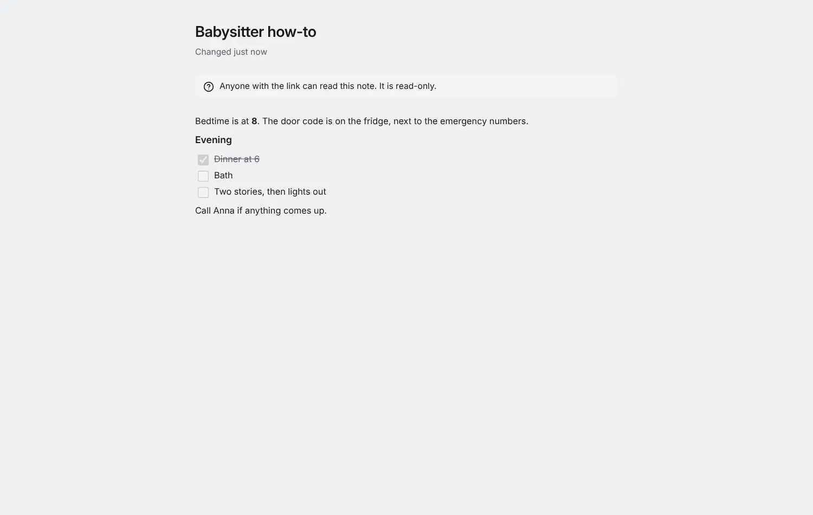

# Note pages

<picture><source srcset="images/note-page-dark.webp" media="(prefers-color-scheme: dark)"></picture>

A note page hands one note to someone who has no account: the babysitter, a guest staying the weekend, a colleague who needs the meeting notes. They open a link and read the note as a calm page: its title, when it last changed, the formatted text with its checklists, the images in place and the files to download. They cannot change anything.

## Publish a note

Open the note, then **Publish note page…** in its menu (the **⋯** button). Add a label if you like (it is shown after the link's secret and says what the page is about) and an expiry: never, or in 7, 30 or 90 days. Then **Publish**. The link is shown once: copy it and send it. Anyone with the link can read the note, so share it like a key.

A note can have one page. While it has one, the note's header says **Published**: open it to see when the page was last opened, to **Copy a new link** (the old one stops working) or to **Revoke** it. You can publish your personal notes; in a shared project, the owner and admins can publish its notes, editors and viewers cannot. Publishing needs a connection.

## What guests see

The page needs no account and sets no cookie; it is not indexed by search engines and sends no referrer. It refreshes every minute while open, and says so when it cannot reach the server. Guests see what you last synced: edit the note offline and the page changes once your device is back online.

Links in the note to other notes, tasks and projects show as the text you wrote and lead nowhere, so nothing else of yours is reachable from the page. Guests never see the note's project, labels, the notes that link to it or anyone's email. Checklists are shown but cannot be ticked.

The page stops working when you revoke it, when it expires, when the note goes to the Trash (it works again if you restore the note), when its project is archived or deleted, or when you can no longer publish the note. Moving a note into a project that is shared differently makes a copy, so the original's link stops working and the copy has no page.

## Encrypted notes

With [end-to-end encryption](e2ee.md), the server cannot read your note, so your device publishes it like an encrypted [task page](task-pages.md): it creates a key for this page only, encrypts a copy of the note with it, and adds the key to the link after `#`. Browsers never send that part, so the server never sees it, and a link without it shows nothing. When you change the note, your device updates the page's copy within a minute of syncing. Images and files are not shown on encrypted pages; the page says so.

## Limits

Note pages share the [task pages](task-pages.md) limits: an account can have 100 active pages of either kind and publish 20 an hour. Revoking deletes the page's copy.
