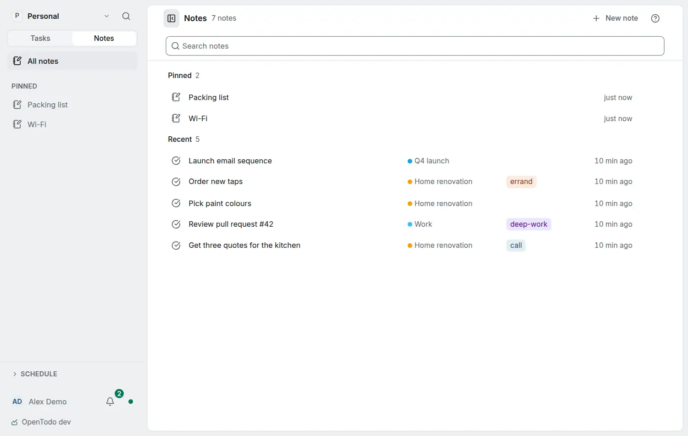

# Note templates

<picture><source srcset="images/notes-home-dark.webp" media="(prefers-color-scheme: dark)"></picture>

A template is a note you start other notes from: a meeting skeleton, a 1:1, a trip plan.

## Your own templates

Write the note as you want every copy to start, then choose **Use as template** in its menu. It stays a note: it syncs, is shared with its project and goes to the Trash like any other. Its row on the [Notes](notes.md) page says *Template*, and typing `template` in the search field lists templates only. **Stop using as template** in the menu makes it a plain note again.

## Starting a note from one

On the Notes page, open the arrow next to **New note** (or press `Shift+Q`) and choose a template: yours come first, then the built-in ones. An open template also has **Use template**. The new note takes the template's title, text, project and labels and opens with the caret in its text. It is a plain copy: changing the template later does not change it. It works offline, **Undo** removes it, and a viewer of the template's project gets the copy without a project.

## Placeholders

These are filled when the note is made, once:

| Placeholder | Becomes |
| --- | --- |
| `{{date}}` | the day, in your date format (after your day start) |
| `{{weekday}}` | the day's name, in your language |
| `{{time}}` | the time, in your time format |
| `{{title}}` | the new note's title |

Write them exactly, without spaces. Anything else in double braces, such as `{{ date }}` or `{{#each}}` in a code block, stays as written.

## Built-in templates

Meeting, 1:1, Trip, Weekly review and Daily ship with the app, in your language where a translation exists. They are never added to your account until you use one. Contributors add more in `templates/notes/` ([the template library](https://github.com/OpenTodoApp/OpenTodo/blob/main/templates/README.md)).

## In routines

**Create a note from a template** (in [Routines](routines.md), under Notes and text) makes a note from a template on a schedule, with the date of the run or one you give, and outputs the note so later steps can add to it. The starter *Monday meeting note* makes a Meeting note every Monday at 09:00 in the project you choose. If the template is moved to the Trash, the run fails with *The template is in the Trash* and writes nothing.
