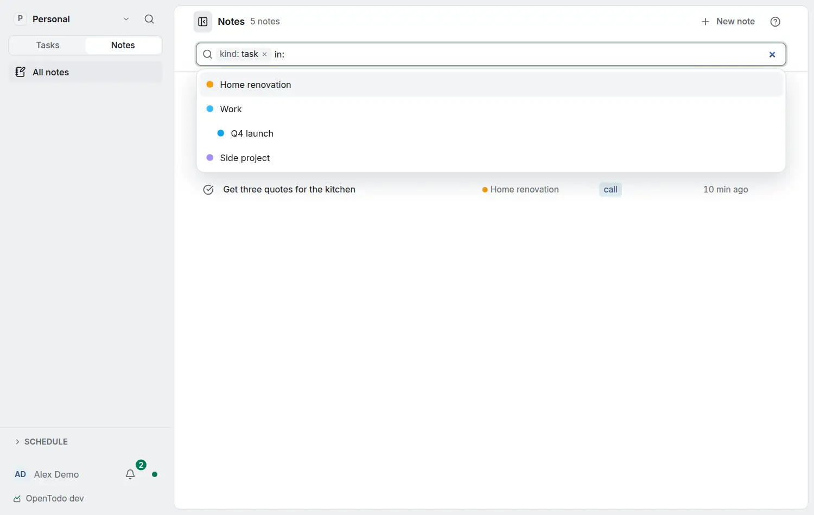

# Narrow notes with tokens

<picture><source srcset="images/note-tokens-dark.webp" media="(prefers-color-scheme: dark)"></picture>

Type a token in the search field to narrow the list; when it is complete and you type a space, or pick it from the suggestions, it becomes a chip. Remove a chip with its **×**, or with <kbd>Backspace</kbd> in an empty field.

| Token | Lists |
| --- | --- |
| `in:Renovation` or `#Renovation` | Notes in that project or one of its sub-projects: standalone notes in it, the notes of its tasks and its own project note |
| `@errand` or `label:errand` | Standalone notes and task notes with that label |
| `kind:note`, `kind:task`, `kind:project` | Standalone notes, task notes or project notes |
| `linked:Trip` | What links to the note "Trip" and what it links to |
| `orphan` | Standalone notes nothing links to |
| `pinned` | Your pinned notes |
| `changed:<7d`, `changed:>30d` | Notes changed in the last 7 days, or more than 30 days ago (`d` days, `w` weeks, `m` months) |
| `changed:today`, `changed:yesterday`, `changed:2026-11-01`, `changed:<2026-11-01`, `changed:>2026-11-01` | Notes changed on, before or after that day |
| `changed:2026-10-01..2026-10-31`, `changed:2026-10-01..`, `changed:..2026-10-31` | Notes changed from the first day to the last, both included; one end left out means on or after, or on or before. The suggestions offer this month and last month |

Names ignore case and accents; put a name with spaces in quotes: `in:"Side projects"`. Tokens of different kinds all apply; two of the same kind list notes with either (`@errand @phone`). After `in:`, `#`, `@`, `label:`, `kind:`, `linked:` or `changed:` the matching values are suggested: <kbd>↑</kbd> and <kbd>↓</kbd> move, <kbd>Enter</kbd> or <kbd>Tab</kbd> picks. While you type the start of a token's name (`kin`, `lab`), <kbd>Tab</kbd> completes it; <kbd>Enter</kbd> still opens the best match. To search for a token's word itself, quote it: `"pinned"`.

A chip keeps naming its project, label or note when it is renamed; once that is deleted, the chip is struck out and lists nothing. The chips are remembered on this device, the words are not. Tokens work on your device, offline and with encryption. They are a feature of the Notes page: `ot notes search` and the assistant tools take a project and labels as options of their own.

