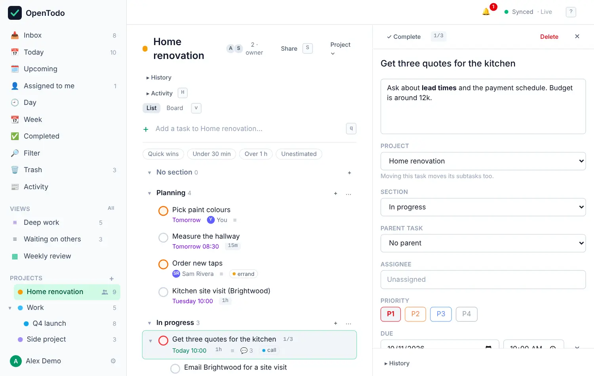

# Notes, subtasks and dependencies

<picture><source srcset="images/task-detail-dark.webp" media="(prefers-color-scheme: dark)"></picture>

In the task panel, **Notes** sits under the title. Below the property lines are the **Subtasks** as a checklist, with an **Add subtask…** line under them, the attachments once there is one (attach from **Add** or the **⋯** menu, or paste or drop files on the panel, see [Attachments](attachments.md)), and the **Comments**, **Activity** and **History** tabs. The comment box rests as one line at the bottom of the panel while Comments is shown and opens when you click it or press <kbd>Shift</kbd>+<kbd>C</kbd>. Activity starts with when the task was created and completed.

## Write notes

The notes field formats as you type: `- ` starts a bullet list, `[ ] ` a checklist, `# ` a heading, and `/` opens a menu with tables, quotes, code, images and more (see [Format notes and comments](formatting.md)). If two of your devices edit the same note at the same time, both sets of changes are kept.

## Break a task into subtasks

Big tasks are easier as a few small steps. To add one:

- open the task and type in **Add subtask**, or
- select the task in the list and press <kbd>a</kbd>.

Subtasks appear indented under their parent, and the parent shows your progress, like **1/3**. You can nest subtasks inside subtasks.

To add several at once, paste a list (up to 100 lines) into the empty **Add subtask** line and confirm **Add 3 subtasks**. Markers such as `-` and `1.` are removed as in [quick add](quick-add.md#paste-a-list), but dates and projects are not read. One **Undo** removes them all.

To turn an existing task into a subtask, select it and press <kbd>Tab</kbd>: it moves under the task above it. <kbd>Shift</kbd>+<kbd>Tab</kbd> moves it back out. You can also pick a **Parent task** in the panel. Use <kbd>←</kbd> and <kbd>→</kbd> to fold and unfold a parent's subtasks.

Completing a parent completes all its open subtasks too. When you tick off the last open subtask, OpenTodo asks whether to complete the parent as well; press <kbd>Enter</kbd> for yes.

## Wait for another task

Some tasks can't start until another is done: you can't book flights before the dates are confirmed. Open the task, choose **Add › Blocked by** (or select it in a list and press <kbd>b</kbd>) and pick the tasks it waits for. The list offers open tasks you can link: the task itself, tasks that already wait for it and tasks shared differently are left out, so you can't make two tasks wait for each other.

While at least one of those tasks is open, the task is **blocked**: its row is dimmed and shows a lock with the number it's waiting for, on boards too, and in Today it moves to a folded **Blocked** group at the end. As soon as the last one is completed (or deleted), the task is ready again, on every device. You can still open, edit and complete a blocked task; completing it doesn't touch the tasks it waited for. A repeating task keeps blocking until its series ends, and **Blocked by** says "repeats" next to it.

"blocks 2" on the **Who** line counts the open tasks waiting for this one; click it to see them and select one to open it. In a shared project, blockers are tasks of the same project, and the person a blocked task is assigned to gets a notification when it's ready to start. Filter for `blocked` or `unblocked` to list them (see [Labels and filters](labels-and-filters.md)).
