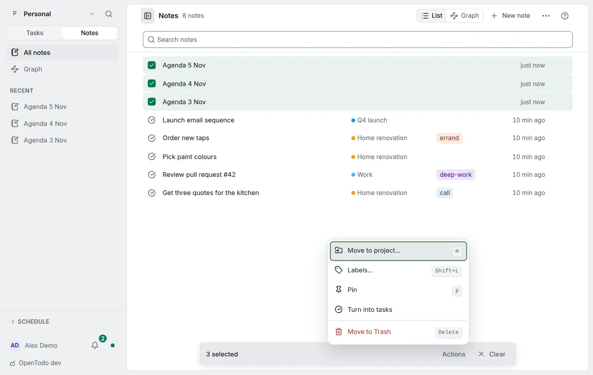

# Act on several notes

<picture><source srcset="images/notes-bulk-dark.webp" media="(prefers-color-scheme: dark)"></picture>

Tick notes the way you tick tasks: press <kbd>x</kbd> (or <kbd>Space</kbd>) on a note, extend with <kbd>Shift</kbd>+<kbd>↓</kbd> or <kbd>Shift</kbd>+<kbd>↑</kbd>, <kbd>Ctrl</kbd>+click or <kbd>Shift</kbd>+click a row, or choose **Select notes** in the page's **⋯** menu. Once one is ticked, <kbd>Ctrl</kbd>+<kbd>A</kbd> ticks every note in the list; <kbd>Esc</kbd> clears.

Only standalone notes you may change are ticked: task notes and project notes belong to their task or project, and notes in a project you can only view are skipped.

While notes are ticked, the bar at the bottom shows how many. **Actions** (or <kbd>.</kbd>) offers:

- **Move to project** (<kbd>m</kbd>). Moving notes into a project shared with other people lists them first: they are copied there and the originals go to the Trash.
- **Labels** (<kbd>Shift</kbd>+<kbd>L</kbd>): a label every ticked note has is removed from all of them, otherwise it is added to those without it.
- **Pin** or **Unpin** (<kbd>p</kbd>).
- **Turn into tasks**: each note becomes a task with its title, text and labels.
- **Move to Trash** (<kbd>Delete</kbd>), which asks first for more than twenty.

Each action is saved at once, offline too, and the message that confirms it offers **Undo** (or <kbd>Ctrl</kbd>+<kbd>Z</kbd> while it shows). A note changed again since keeps its new value and is named. Selection is not kept when you leave the page or switch to Graph.
