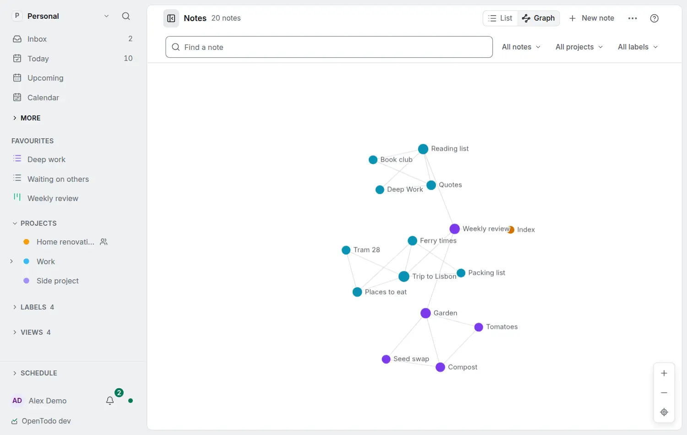

# See all your notes as a graph

<picture><source srcset="images/notes-graph-dark.webp" media="(prefers-color-scheme: dark)"></picture>

The **Notes** page has two modes, **List** and **Graph**, at its top right (on a phone, the button beside the title) and under **All notes** in the sidebar. Graph draws every note of the workspace, your own, your projects' and your tasks', with a line between every two that link. Tasks and projects a note links to without a note of their own are small hollow marks. A note takes its project's colour and its kind's shape: a circle for a note, a square for a task, a diamond for a project. The mode is in the address (`/notes?view=graph`), and Notes opens in the mode you used last on this device.

- **Move around:** drag to pan; zoom with the wheel, a pinch or **+** and **−**; the target button fits everything.
- **Look:** point at a note (on a phone, tap it once) to light it and its neighbours.
- **Open:** click a note; it opens beside the graph and <kbd>Esc</kbd> closes it. On a phone, tap again: it opens as its page, and Back returns to the graph.
- **Centre:** double-click a note to keep its neighbourhood lit, one, two or three links deep; <kbd>Backspace</kbd> goes back to the previous centre.
- **Find:** type in **Find a note**; <kbd>Enter</kbd> moves to the next match.
- **A topic:** chips in the search field, such as `in:` a project or `label:`, dim everything outside them, in place. A task's note counts with its task's project and labels.
- **What is drawn:** the menu (**…**) shows **Notes without links** (hidden at first) and hides **Tasks and projects without notes**.

The picture stays put: the same notes always give the same layout, your device remembers where each note is, and a new note appears beside its links without moving the others.

| Key (graph focused) | What it does |
| --- | --- |
| <kbd>←</kbd> <kbd>→</kbd> <kbd>↑</kbd> <kbd>↓</kbd> | Move to the linked note that way; its title, kind and links are read out |
| <kbd>Enter</kbd> / <kbd>Space</kbd> | Open / centre the focused note |
| <kbd>+</kbd> <kbd>−</kbd> <kbd>0</kbd> | Zoom in, out, fit |
| <kbd>v</kbd> | Switch between List and Graph |

The List shows the same notes as rows, for reading and for screen readers.

## Private and offline

The graph is drawn on your device from your own copy, so it works offline and with [end-to-end encryption](e2ee.md), and nothing is sent to the server. It shows only items you can open. For one item's links, see [See an item's connections](note-connections.md).
