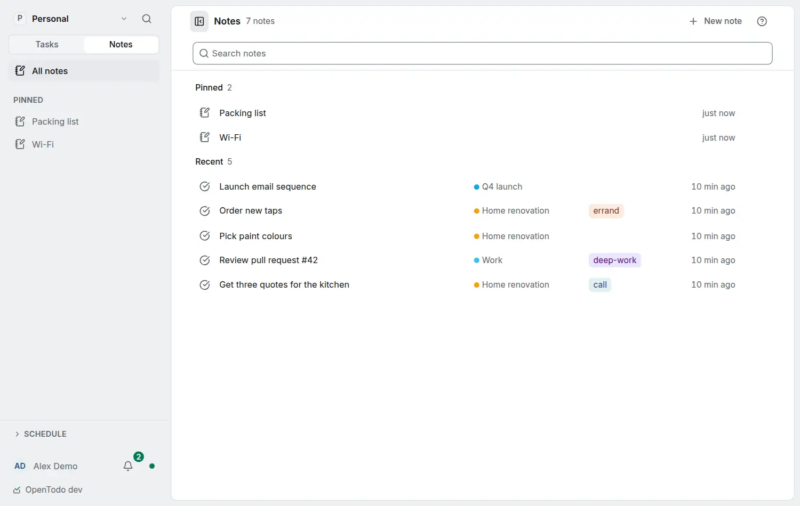

# Find, pin and start notes

<picture><source srcset="images/notes-home-dark.webp" media="(prefers-color-scheme: dark)"></picture>

The search field is the first thing on the [Notes](notes.md) page. Press `/` to reach it from anywhere on the page.

## Searching

The search field finds notes whose title or text contains every word you type, ignoring letter case and accents, so `cafe muller` finds "Café Müller". Put words in quotes to find them as a phrase: `"oat milk"`. Formatting does not get in the way: `**oat** milk` is found as "oat milk". Each result shows the text around the first match with the words highlighted, title matches first. Search runs on your device over your own copy, so it works offline and with [end-to-end encryption](e2ee.md); nothing you type is sent to the server.

<kbd>↑</kbd> and <kbd>↓</kbd> move through the results while you type, and <kbd>Enter</kbd> opens the best match. <kbd>Esc</kbd> moves to the list, where `j` and `k` move and <kbd>Enter</kbd> opens.

To narrow the list by project, label, kind, links or age, type tokens such as `in:Renovation` or `@errand`: see [Narrow notes with tokens](note-tokens.md).

The command palette (`Ctrl+K`, `⌘K` on a Mac) finds notes too, in a **Notes** section, and a task found by its note shows the matching text. In [filters](filters.md), `notes` lists tasks that have a note, `no notes` those without, and `notes: text` tasks whose note contains the text.

## Start a note from the search field

While you type, the first row reads **New note "…"** with your text. When no note matches, it is already chosen: press <kbd>Enter</kbd> and the note is created with that title and opens with the caret in its text, so you can go on writing. When notes match, <kbd>Enter</kbd> opens the best match; press <kbd>↑</kbd> first to create the note instead. The new note goes into the project of an `in:` chip and gets the labels of the `@` chips. **Undo** removes it.

## Pinned notes

Choose **Pin** in a standalone note's menu (in the list, or in the note itself), or press `p` on a note in the list. Pinned notes are listed first, under **Pinned**, in the order of your Favourites, and the others follow under **Recent**. Pinned notes are also listed under **Pinned** in the sidebar's Notes side, where a note's menu (or <kbd>Alt</kbd>+<kbd>↑</kbd> and <kbd>↓</kbd>) moves it up or down or unpins it. On a phone, a long press on a row opens its menu.

Pins are yours: in a shared project, other members do not see your pins. They sync to your other devices, offline included. A pinned note in the Trash leaves Pinned and comes back when you restore it. Searching or filtering shows one list, with pinned notes in their usual place. Older versions of the app keep your pinned notes and do not show them. Assistants can pin and unpin notes with `set_favourite` ([MCP](mcp.md)).

## Notes nothing links to

The `orphan` token lists the standalone notes that no other note, task or project links to, newest first. A note that only links elsewhere still counts as unlinked. It is worked out on your device, like [Linked references](note-links.md), so it works offline and with encryption.
