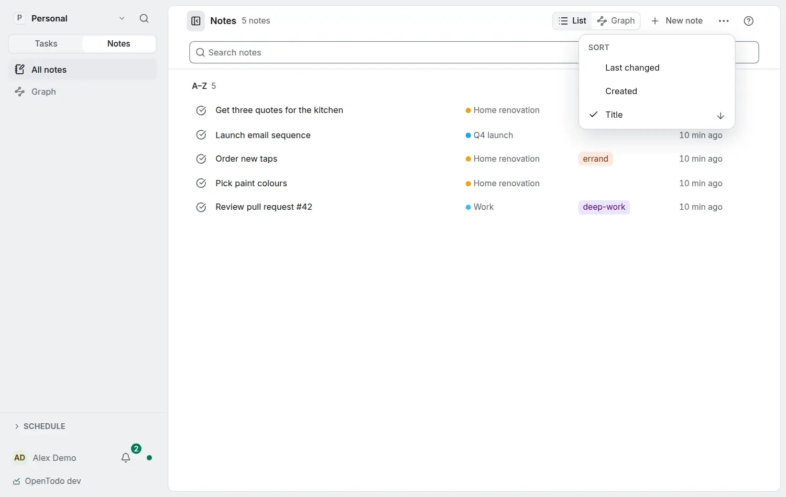

# Sort notes

<picture><source srcset="images/notes-sort-dark.webp" media="(prefers-color-scheme: dark)"></picture>

Choose **Sort** in the **⋯** menu of the Notes page header:

- **Last changed** (the default): the note changed last comes first.
- **Created**: the newest note first. A task's or project's note counts from when the task or project was created.
- **Title**: A to Z in your language's order, with numbers in order ("Week 2" before "Week 10"). Untitled notes come last.

Choose the checked order again to reverse it; the arrow beside it shows the direction, and the heading over the list names the order (**Newest**, **A–Z**, **Z–A**…).

Pinned notes keep the order you pinned them in. Tokens such as `in:Renovation` keep the order you chose. While you search with words, results are ranked by how well they match; clear the words and the list is sorted again. Graph mode is not affected.

Each device keeps its own order, offline included; it is not synced.
