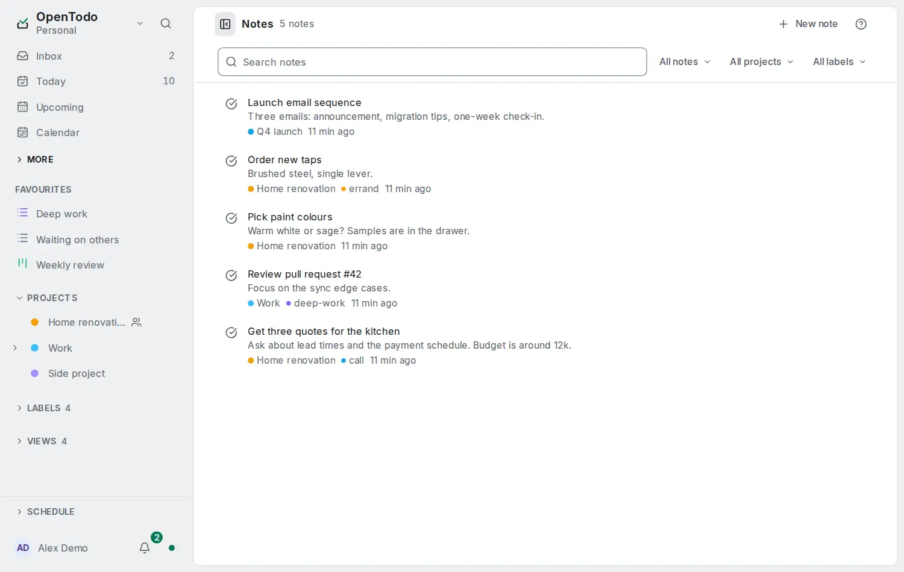

# Notes, tasks and scripts

<picture><source srcset="images/notes-dark.webp" media="(prefers-color-scheme: dark)"></picture>

A note on the [Notes](notes.md) page can become a task, and a task's note can become a note of its own.

## Turning notes into tasks and back

- **Turn into task** (in a standalone note's menu) makes a task with the note's title, text, project and labels, and moves the note to the Trash.
- **Move note to a new note** (in a task's menu) moves the task's note out into a new standalone note titled like the task, in the task's project; the task keeps its title and its note becomes empty.

Both can be undone with **Undo**. Viewers of a shared project are offered neither. Both work offline and reach your other devices on the next sync.

## Trash

A deleted note goes to the [Trash](trash-and-history.md) with tasks and projects. Restore it from there, or delete it permanently; the Trash empties itself after the retention period like for tasks, and a project deleted permanently takes its notes with it.

## From scripts and assistants

`ot notes` lists, searches, shows, adds, edits, appends to and removes notes, and `ot task note` reads and writes a task's note as Markdown (see [the command line](cli.md)). AI assistants connected over [MCP](mcp.md) can read and search notes and, when you allow it, create and change them. Text added this way is appended at the end of the note without replacing what you wrote, even while you edit the same note on another device. A replacement of the whole text is refused when the note changed since the script or assistant read it.

Links between notes are Markdown: `[Trip](?note=<id>)`, `[Call the plumber](?task=<id>)` or `[Renovation](?project=<id>)`, so a script or an assistant links by writing that text. `ot notes links <ref>` lists what a note links to and the notes that link to it, worked out on your machine (it needs `ot encryption unlock` on an encrypted account). On an account without end-to-end encryption, the assistant tools `get_note` and `get_task` return the same as `links` and `linked_from`; on an encrypted account they return neither, because the server cannot read the notes.

[Routines](routines.md#notes-in-routines) can turn notes into tasks for you: when a note gets the label todo, or the open checkboxes of a note you run a routine on.

Notes are not sent to calendar apps over CalDAV, to webhooks, to the activity feed or to the Markdown vault.
