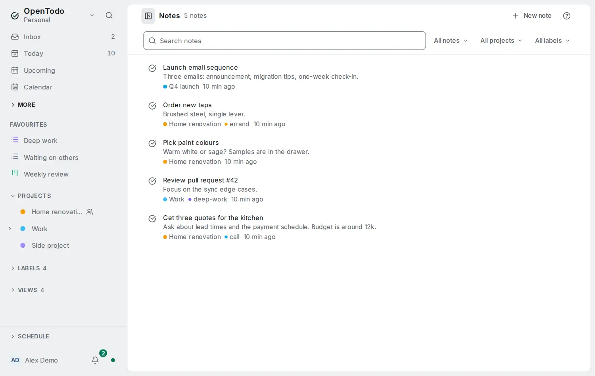

# Notes

<picture><source srcset="images/notes-dark.webp" media="(prefers-color-scheme: dark)"></picture>

The **Notes** page lists everything you have written: the notes of your tasks, the notes of your projects, and notes that are not tasks at all, such as meeting notes, a reference page for a project or a packing list you keep for next year. Open it from **More** in the sidebar, or press `g` then `e`.

## The list

Notes are listed with the most recently changed first, 50 at a time; **Show more** adds the next 50, and the count beside it says how many there are in all. A note counts as changed when its text changes: moving a task to another day does not move its note up the list.

Each row shows where the note lives (a task, a project or a standalone note), its title, the first line of its text, the project, the labels and when it last changed. A completed task and an archived project are marked. Open a row to read or edit it: a task's note opens the task, a project's note opens the project with its note ready to edit, and a standalone note opens beside the list on a computer and as its own page on a phone.

Narrow the list with **Source** (All, Task notes, Project notes, Standalone only), **Project** and **Label**. The filters are remembered on this device. On a phone they are behind **Filters**.

## Writing a note

**New note** (or `q` on the page) creates a standalone note. Give it a title, write in it with the same formatting as task notes (headings, lists, checklists, tables, links, code), and choose a project and labels below it if you like. A note without a title reads "Untitled note". Notes save on your device as you type and sync like everything else, offline included.

There are no folders: projects and labels organise notes. A note in a shared project is shared with that project: editors can change it and viewers can read it. A single note cannot be shared on its own. Moving a note into a project that is shared differently makes a copy there and removes the original, as for tasks.

Mentions, images and **Make subtask** are not offered in standalone notes: they need a task.

## Searching

The search field finds notes whose title or text contains every word you type, ignoring letter case and accents, so `cafe muller` finds "Café Müller". Put words in quotes to find them as a phrase: `"oat milk"`. Formatting does not get in the way: `**oat** milk` is found as "oat milk". Each result shows the text around the first match with the words highlighted, title matches first. Search runs on your device over your own copy, so it works offline and with [end-to-end encryption](e2ee.md); nothing you type is sent to the server.

The command palette (`Ctrl+K`, `⌘K` on a Mac) finds notes too, in a **Notes** section, and a task found by its note shows the matching text. In [filters](filters.md), `notes` lists tasks that have a note, `no notes` those without, and `notes: text` tasks whose note contains the text.

To turn a note into a task, move a task's note out, or work with notes from scripts and assistants, see [Notes, tasks and scripts](notes-to-tasks.md).
