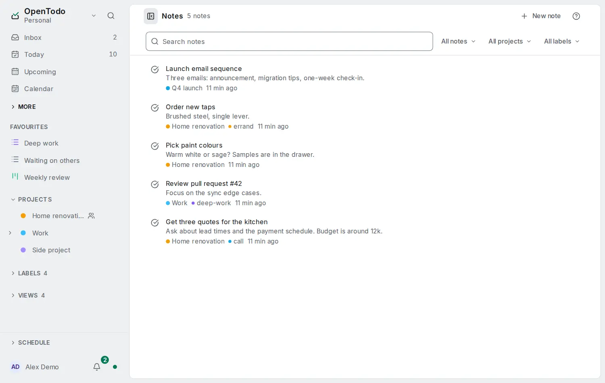

# Notes

<picture><source srcset="images/notes-dark.webp" media="(prefers-color-scheme: dark)"></picture>

The **Notes** page lists everything you have written: the notes of your tasks and projects, and notes that are not tasks at all, such as meeting notes or a packing list. Switch the sidebar to **Notes** with the control under the workspace name, or press `g` then `e`.

## Tasks and Notes in the sidebar

The control at the top of the sidebar switches it between **Tasks** (Inbox, Today, projects, labels) and **Notes**: **All notes**, your pinned notes and the five changed last. Choosing a side opens its home. Opening a note shows Notes, opening a task or task view shows Tasks; Settings and Help leave it as it is. Each device remembers its side; on a phone the control tops the menu and the tab bar stays.

## The list

Notes you pin come first, under **Pinned**; every other note follows under **Recent**, the latest change first unless you [sort them](notes-sort.md), 50 at a time; **Show more** adds the next 50, and the count beside it says how many there are in all. A note counts as changed when its text changes: moving a task to another day does not move its note up the list.

Each note is one line: its kind (a task, a project or a standalone note), its title, where it lives (its project, the task's project, or Inbox for a task without one), its labels and when it last changed. A completed task and an archived project are marked. Open a row to read or edit it: a task's note opens the task, a project's note opens the project with its note ready to edit, and a standalone note opens beside the list on a computer and as its own page on a phone.

Narrow the list with tokens such as `in:Renovation` or `@errand`: see [Narrow notes with tokens](note-tokens.md).

## Writing a note

**New note** (or `q` on the page) creates a standalone note, and so does typing a title in the search field and pressing <kbd>Enter</kbd> when no note matches. Give it a title, write with the same formatting as task notes, and choose a project and labels below it if you like. A note without a title reads "Untitled note". See [Note templates](note-templates.md). Notes save on your device as you type and sync like everything else, offline included. On a computer, resize the note beside the list by its left edge: drag it, click it (widest, then back), or focus it and press ← or →; each device keeps its own width.

There are no folders: projects and labels organise notes. A note in a shared project is shared with that project: editors can change it and viewers can read it. A single note cannot be shared on its own. Moving a note into a project that is shared differently makes a copy there and removes the original, as for tasks.

Mentions, images and **Make subtask** need a task.

## Linking notes, tasks and projects

Type `[[` in a note to link to another note, a task or a project; what links to a note shows at its end. See [Link notes, tasks and projects](note-links.md). **Show connections** draws one item's: [See an item's connections](note-connections.md); **Graph** shows them all: [See all your notes as a graph](notes-graph.md).

## Searching and pinning

Search and its tokens, writing from the search field and pinned notes are described in [Find, pin and start notes](notes-home.md).

To turn a note into a task, move a task's note out, or work with notes from scripts and assistants, see [Notes, tasks and scripts](notes-to-tasks.md).
