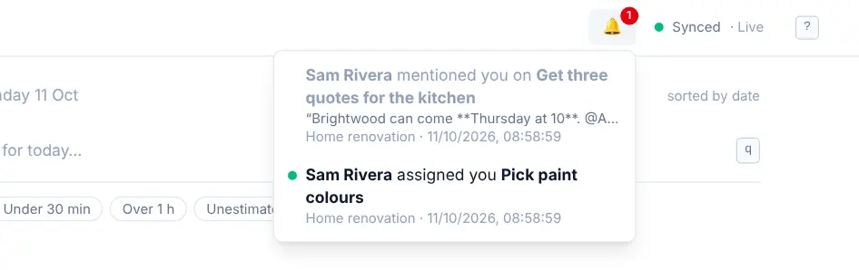

# Notifications

<picture><source srcset="images/notifications-dark.webp" media="(prefers-color-scheme: dark)"></picture>

OpenTodo tells you about four things: a task someone assigned to you, a comment that mentions you, a task of yours that is ready to start, and reminders you set. Nothing else, and never anything from outside your server.

## The bell

The bell at the bottom of the sidebar shows a small dot when one new thing arrived from other people, and a small count when more did:

- **assigned you**: someone assigned you a task in a shared project,
- **mentioned you**: someone wrote `@your name` in a comment,
- **is ready to start**: someone completed the last task that a task assigned to you was [waiting for](tasks-and-projects.md#wait-for-another-task), for example "Sam completed Confirm dates: Book flights is ready to start". It's in the bell only, not sent as a push notification.

Select an entry to open the task. Opening the task marks it as read. You don't get notified about your own actions.

## Reminders inside the app

While OpenTodo is open, a reminder appears in the corner of the screen when it's due, with **Snooze 10 min**, **1 hour**, **Tomorrow 09:00** and **Dismiss**. It needs no permission and no connection. Press <kbd>Esc</kbd> to dismiss it.

If the OpenTodo tab is in the background and your browser allows notifications for it, you get a system notification instead.

How to add reminders is covered in [Recurring tasks and reminders](recurring-and-reminders.md#add-a-reminder).

## Get reminders when the app is closed

Push notifications deliver reminders even when OpenTodo isn't open, and each device decides for itself: open **Settings → Notifications** on the device, turn on **Enable notifications on this device**, allow notifications when the browser asks, then select **Send test notification**. Repeat it on your phone, laptop and tablet. The full steps are in [Push notifications](push-notifications.md).

### Check that it works

Below the options, **Delivery check** lists everything push needs on this device, with a fix next to each problem, and the test notification reports whether this device received it. Every step and result is explained in [Check that push works](push-delivery-check.md).

### On iPhone and iPad

Push needs iOS or iPadOS 16.4 or later and only works in the installed app, opened from the home screen. See [On iPhone and iPad](push-notifications.md#on-iphone-and-ipad).

### Privacy

A push message contains only an id and a time, encrypted so the push service can't read it; the title travels with it only when you turn on **Include task titles**. See [Privacy](push-notifications.md#privacy).

### Language

The text of a notification (**Due** and the date, **Snooze 10 min**, **Dismiss**, the test message) is written in your [interface language](language.md), read on the device from your synced preferences, so it needs nothing from the server. A device that has not synced your preferences yet writes it in English.

## A weekly digest by email

Besides reminders, you can get one email a week with last week's numbers and what needs attention. Turn it on in **Settings → Notifications → Weekly digest**; see [Statistics and the weekly digest](statistics.md#weekly-digest-by-email). It counts days from your [day start](dates-and-times.md#when-a-day-ends), like the Statistics screen.

## When notifications don't arrive

Notifications blocked for the site, push switched off on the server, a browser without push, a test that is accepted but not received, a phone holding notifications back, or a development build: each has a fix in [When notifications don't arrive](push-notifications.md#when-notifications-dont-arrive). More fixes in [Troubleshooting](troubleshooting.md).
