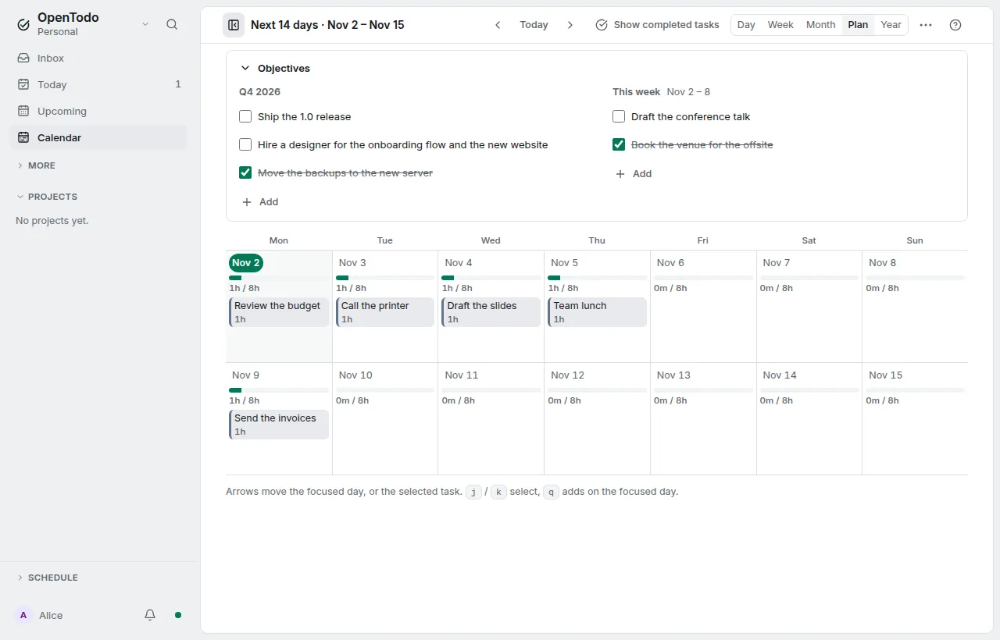

# Objectives

<picture><source srcset="images/objectives-dark.webp" media="(prefers-color-scheme: dark)"></picture>

A daily list makes it easy to lose sight of what the quarter and the week are for. **Objectives** are a few short lines pinned to a quarter or a week, shown where you plan: above the [Plan](calendar-views.md#plan-the-next-two-weeks) and in the [weekly review](review-and-statistics.md). An objective is one line of up to 140 characters with a done checkbox; there are no key results, percentages, linked tasks or charts.

## Turn them on

Turn on **Objectives** in **Settings → Account → How you work**, whatever way of working you chose. It syncs to your devices. Off hides the strip and the review section and keeps every objective, still in your export, the API, the CLI and AI assistants' reads.

## Five per period

A quarter (`2026-Q4`) and an ISO week (`2026-W44`) each hold at most **five open objectives**. At five, **Add** is gone and the group says "Five is plenty. Finish or drop one first." Done ones do not count. If two offline devices each added one, you may see six: every device shows them all, offers no Add until fewer than five are open, and deletes nothing.

## In the Plan

An **Objectives** strip sits above the Plan's columns: this quarter's objectives, this week's with its dates, and next week's when the Plan starts in next week.

Click a title, or press <kbd>Enter</kbd> on it, to edit it in place. <kbd>Space</kbd> marks it done, <kbd>Delete</kbd> asks in place before dropping it, and <kbd>Alt</kbd>+<kbd>↑</kbd>/<kbd>↓</kbd> or a drag changes the order. <kbd>Escape</kbd> leaves editing. Each change can be undone.

A done objective stays, struck through, until its week or quarter ends; past periods are not shown. The heading collapses the strip, remembered per device. On a phone the strip is one line, such as "Q4: 3 · This week: 2", that opens the cards in place.

## In the weekly review

**Look ahead** starts with:

1. this quarter's objectives, for reference;
2. **Objectives for next week** when you review from Friday to Sunday, **Objectives for this week** otherwise, with Add and editing; **Plan this week instead** switches;
3. the week before's open objectives, each with **Carry** (to the week you plan), **Done** and **Drop**.

In your first review of a new quarter, last quarter's open objectives get the same choices, carrying to the current quarter. The section never changes whether the step is done.

## Carry-over is yours

Nothing moves, completes or deletes an objective when its period ends. It leaves the strip, is offered once in the review, and keeps its period.

## Encryption

With [end-to-end encryption](e2ee.md) the title is encrypted on your device; the period, order and done time are not. Enabling encryption later re-writes existing titles. AI assistants get the title only through a device you allowed to answer for them, otherwise `null` with `encrypted: true`.

## API, CLI and AI assistants

The [API](api.md#objectives) has the `objectives` collection (a sixth open one is `409 too_many_objectives`), the [CLI](cli.md#objectives) has `ot objectives`, and [MCP](mcp.md) has the read-only `list_objectives` and `opentodo://objectives`. Objectives are personal: they sync to your own devices only, also in a shared workspace.
