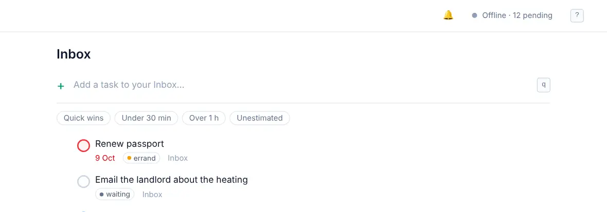

# Offline and sync

<picture><source srcset="images/sync-status-dark.webp" media="(prefers-color-scheme: dark)"></picture>

OpenTodo keeps a full copy of your tasks on each device. Everything you do happens on that copy first, so the app is fast and works the same with or without a connection. Your server keeps every device up to date and holds the backup.

## Working offline

On a train, a plane or in a basement with no signal, you can keep going: add tasks, complete them, edit notes, move cards on a board, comment. Changes wait on the device and are sent as soon as there's a connection again. You don't have to do anything.

The installed app even starts without a connection. See [Installing the app](install-app.md).

A few things need the server and say so when you're offline: changing your password, setting up passkeys or two-factor authentication, inviting people, importing files, and the full history of a task.

## The sync status

The status at the top right tells you where things stand.

| Status | Means |
| --- | --- |
| **Synced** | Everything on this device is on the server, and the other way round |
| **Syncing…** | Sending or receiving changes right now |
| **3 pending** | Changes are waiting to be sent; they'll go in a moment |
| **Offline · 3 pending** | No connection, or no answer within 30 seconds; 3 changes will be sent when it's back |
| **Sync error** | The server answered with a problem; hover over the status for details |
| **Signed out** | Your session ended; sign in again and waiting changes are sent |
| **Locked** | Your account uses [encryption](e2ee.md) and this device needs your passphrase |

The count is of individual changes, not tasks: one new task with a date and a label counts as several.

**Live** next to the status means this device gets other devices' changes within seconds. Without it, the app still checks regularly, just less often. Click the status to sync now.

## Several devices

Use OpenTodo on as many devices as you like. A task added on your phone appears on your laptop within seconds when both are online. A device that was off catches up the next time it opens.

## When two devices change the same task

You don't need to resolve conflicts. OpenTodo tracks each field of a task separately: title, date, priority and so on.

- If your phone changes the **date** and your laptop changes the **priority**, both changes are kept.
- If both change the **same** field, the change made last wins on every device.
- **Notes** are merged: if you type in the same note on two devices, both sets of edits end up in it.
- If one device deletes a task while another edits it, the task stays deleted. You can restore it from the Trash, edits included.

The same rules apply to people in a [shared project](sharing.md).

## Signing out

Signing out (**Settings → Account → Sign out here**) removes your tasks from that device. If you're online, waiting changes are sent first. Your data stays on the server, and signing in again downloads it.

## Tips

- On a shared computer, sign out when you're done.
- A device that was offline for weeks needs a minute after reconnecting to catch up; wait before you reorganise.
- Your data lives on your server; you can download all of it at any time. See [Import and export](import-export.md).
- The [sync protocol](sync.md) describes how it works under the hood, for the curious.
