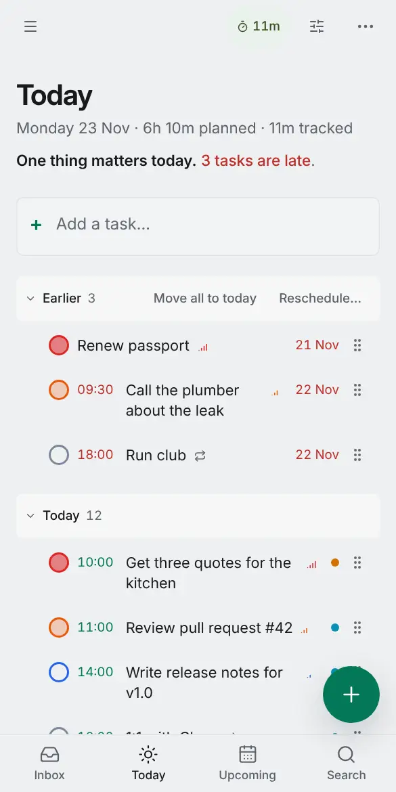

# Phone screens

<picture><source srcset="images/mobile-today-dark.webp" media="(prefers-color-scheme: dark)"></picture>

On a phone OpenTodo shows screens designed for a phone from the start, in the apps and in a phone's browser alike. They cover every **task list** (the Inbox, Today, Upcoming, Anytime, Someday, Assigned to me, Completed, a label, a location and a project as a list) and the **task page**. Every other screen keeps its content and gets the same bar, title and task rows.

There is nothing to turn on: every screen narrower than 768 px shows them, and a wider one the screens of a computer.

## The task lists

Every list shows the same tasks, groups and order as on a computer, and does the same things.

- **Rows.** Each group is one card. Under a task's title, one line holds its time or date, subtasks, repeat and project. Subtasks sit under their task; the arrow at its end folds them.
- **Tap, swipe, hold.** Tap a task to open it or its circle to complete it with **Undo**. Swipe right to complete. Swipe left briefly to edit the title in place or farther to schedule. Hold and release for the task menu, or hold and move to reorder a list you order by hand.
- **The menu.** The bar's menu holds display options, filters, **Select tasks** and the list's own items, such as Today's limit and a project's layout.
- **Selecting.** **Select tasks** turns the circles into tick boxes. The bar at the bottom acts on the ticked tasks; **Close** ends the selection.
- **Adding.** The add button adds to the list on screen; a list has no add field of its own. A task's menu has **Add task below** and **Add subtask**.
- **Each list's own parts** stay, such as Today's briefing and the Inbox's **Process**.
- **At a glance.** Today opens with cards for what is up next, done and late; Upcoming with the next seven days. Tap one to go there.
- **Shortcuts.** Drag a task onto a day of Upcoming's week. Hold **Today** in the tab bar for the day's next task, **Inbox** to add one.

## The task page

- The title and the note come first.
- What the task has is a list of rows: its date, project, priority, labels and so on. Tap a row to change it.
- What the task does not have yet is a row of buttons under them: **Deadline**, **Reminder**, **Repeat** and the rest.
- Subtasks, custom fields, attachments, comments, activity, time and history follow, as before.
- The bar has **Back** with the name of the list you came from, the next and previous task, and the task's menu.

### Choosing a date

The **Do** row opens a sheet made for a phone: **Today**, **Tomorrow**, **This weekend** and **Next week** with the date each one means, then a month with days large enough for a thumb, then the time of day. A tap on a choice or a day sets the date and closes the sheet; a task keeps its time. **Clear** removes the date. In lists, a full swipe left opens this sheet and also offers **Someday**.

## The calendar

In **Week**, **Month** and **Plan** a task is the row of the lists: tap to open, the circle completes, swipe left to move it to another day. In **Day**, hold a block near an edge to change its length.

## Tell us

If something was easier before, tell us with **Feedback and problems** in the menu.
