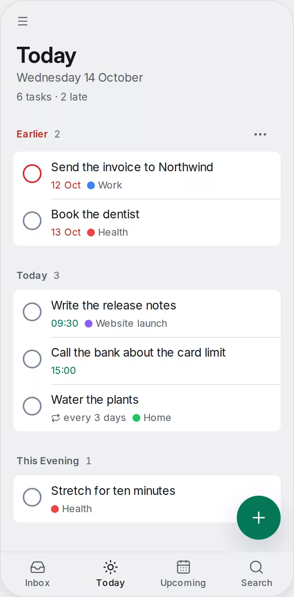

# New phone screens

<picture><source srcset="images/phone-screens-dark.webp" media="(prefers-color-scheme: dark)"></picture>

OpenTodo on a phone has so far been the same screens as on a computer, rearranged to fit. **New phone screens** is a trial of screens designed for a phone from the start. It covers two of them, **Today** and the **task page**; every other screen is as before.

## Turn it on

On your phone, open **Settings → Appearance → Theme and density** and turn on **New phone screens** at the end of the page. The switch is only shown on a screen narrower than 768 px. It takes effect at once, and turning it off brings the earlier screens back.

The choice is kept on that phone. It is not synced: your other devices, and a tablet or a computer, are not affected, and nothing is sent to the server. It works in the Android and iPhone apps and in a phone's browser alike.

## Today

- Each group is one card of tasks. Under a task's title, one line holds what matters: its time or date, its subtasks, its repeat and its project.
- Tap a task to open it. Tap its circle to complete it; **Undo** is offered as before. Swipe right to complete, swipe left to choose a date.
- Calendar events for today are a card at the top, when you show them in Today.
- To add a task, use the add button. The page has no add field of its own.
- The overdue group's **Move all to today** and **Reschedule** are in the menu at the end of its name.
- **Done today**, at the end, opens the tasks you completed.

The list is the same one Today shows on a computer: the same tasks, groups, order and [Today limit](today-limit.md). Reordering by dragging is not part of this trial.

## The task page

- The title and the note come first.
- What the task has is a list of rows: its date, project, priority, labels and so on. Tap a row to change it.
- What the task does not have yet is a row of buttons under them, one each: **Deadline**, **Reminder**, **Repeat**, **Estimate** and the rest. Nothing is behind a "more" control.
- Subtasks, custom fields, attachments, comments, activity, time and history follow, as before.
- The bar has **Back** with the name of the list you came from, the next and previous task, and the task's menu.

### Choosing a date

The **Do** row opens a sheet made for a phone: **Today**, **Tomorrow**, **This weekend** and **Next week** with the date each one means, then a month with days large enough for a thumb, then the time of day. A tap on a choice or a day sets the date and closes the sheet; a task keeps its time. **Clear** removes the date. The same sheet opens when you swipe a task to the left in Today, where it also offers **Someday**.

## What this is for

It is a trial, to find out whether screens made for a phone feel like an app. If they do, the other screens follow and the switch will be on by default; if they do not, it will be removed. Tell us what you notice with **Feedback and problems** in the menu.
