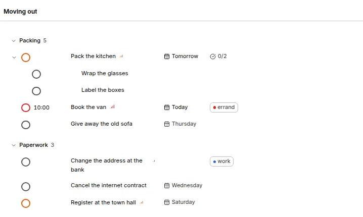

# Print a list

To have a list on paper, open it (the Inbox, Today, Upcoming, a project, a label or a saved view) and print it with your browser's Print (<kbd>Ctrl</kbd>+<kbd>P</kbd>, or <kbd>Cmd</kbd>+<kbd>P</kbd> on a Mac), or select **Print…** at the end of the list's **…** menu.

You get the list as it is on screen, black on white whatever your theme: the title, the groups, every task with its subtasks, time, date, project and labels, and an empty circle to tick by hand. The sidebar and the buttons are left out, and a long list continues over as many pages as it needs.

Folded groups and tasks stay folded, so unfold what you want on paper first. A project prints in the List layout; switch to it from Board, Timeline or Calendar.

To keep a PDF instead, choose **Save as PDF** as the printer. The Android and iOS apps can't print yet: use the web app in a browser.
