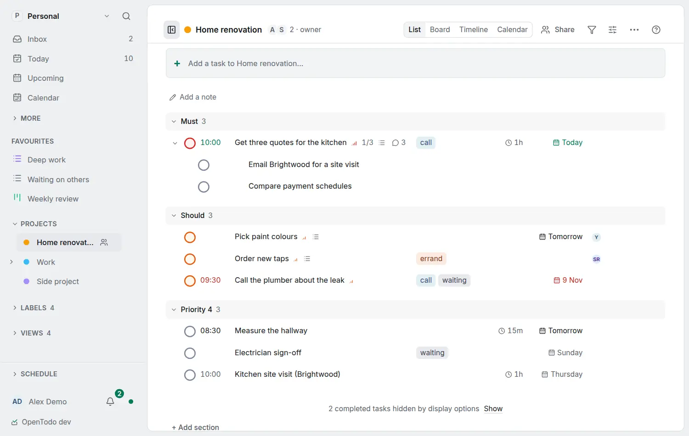

# Name your priorities

<picture><source srcset="images/priorities-dark.webp" media="(prefers-color-scheme: dark)"></picture>

The four priorities are called **Priority 1** to **Priority 3** and **No priority** until you give them your own words: *Must*, *Should*, *Could*, *Won't*, or *Today*, *This week*, *Soon*, *Whenever*.

## No priority

Every task starts at the fourth level, and while that level has no name of yours it reads as **No priority**: the task panel shows a faint **Priority**, rows show no priority mark, and the priority picker offers **None**. To take a priority away, choose **None** (or press `4` with the task selected). The task keeps the number 4, so `p4` in quick add and filters, the API and the command-line client work as before; in `ot`'s table the priority column stays empty for it. Give the fourth level a name, such as *Whenever*, and that name shows instead.

## Rename a level

Open **Settings → General → Priorities** and type a name beside each level's colour. It applies as you type, on all your devices, offline too. A name is one line of up to 24 characters. Leave a field empty for the default, or choose **Reset** to bring back all four.

## Where the names show

Wherever a priority does: the task's facts and the priority menus, the quick-add chips, list groups and board columns grouped by priority, the filter builder ("Priority is Must"), bulk actions, the command bar, the shortcut sheet and the assistant's proposals. A screen reader hears the name and the number ("Must, priority 1"). Colours and order stay the same, and no task changes: a task's priority is still the number.

## The numbers stay the syntax

`p1` to `p4` keep working in [quick add](quick-add.md) and in [filters](labels-and-filters.md#find-tasks-with-a-filter), so saved views and [routines](routines.md) never break when you rename a level. Typing `p` after a space in quick add lists the four levels with their names, and picking one inserts its number.

The API, the [command-line client](cli.md), AI assistants over [MCP](mcp.md), calendar apps, the weekly digest and emails keep using the numbers.

## Yours alone

Names are personal. In a shared project each member sees their own words for the same priority, and nobody else sees yours. With [end-to-end encryption](e2ee.md) the names are encrypted like label names; a locked device shows the default names until you unlock it.
