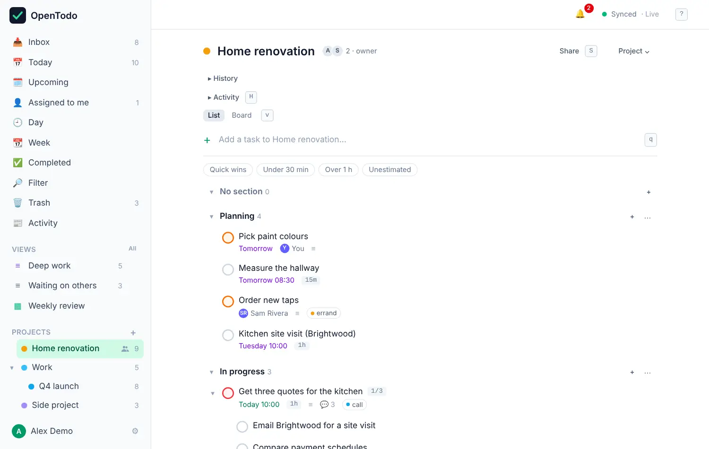

# Projects and sub-projects

<picture><source srcset="images/project-list-dark.webp" media="(prefers-color-scheme: dark)"></picture>

Projects keep related tasks together, and projects can sit inside other projects.

## Organise with projects

To create a project, click **+** next to **Projects** in the sidebar, type a name and choose **Create**. Pick a parent project in the same form to make it a sub-project. Inside a project, [quick add](quick-add.md) puts new tasks in it.

The **Project** menu at the top right of a project lets you:

- pick a **colour** from the swatches at the top,
- **Pin to sidebar**, which adds it to **Favourites** (see below),
- **Move to…** another project, or back to the top level. Type to find the target; <kbd>m</kbd> opens the menu straight at this step.
- **Rename** it,
- **Archive…** it, which hides it and its sub-projects from the sidebar while keeping every task,
- **Delete project…**, which moves it to the Trash.

Archive and delete ask first and say what they affect.

<picture><source srcset="images/project-move-dark.webp" media="(prefers-color-scheme: dark)"></picture>

A project's open-task count shows in the sidebar on hover or focus (always on touch). A folded project counts its sub-projects.

Inside a project you can also group tasks into sections and show them as a board: see [Sections and boards](sections-and-boards.md).

## All projects and favourites

**All** next to **Projects** in the sidebar (or <kbd>g</kbd> then <kbd>Shift</kbd>+<kbd>P</kbd>) opens the **Projects** page: the whole tree with counts, a field to find a project (<kbd>Enter</kbd> opens the first match), **New project**, **From a template…**, and your [archived projects](archived-projects.md) at the bottom.

**Pin to sidebar** in the menu of a project, a label or a saved filter puts it in **Favourites** at the top of the sidebar. **Move up** and **Move down** in its menu there, or <kbd>Alt</kbd>+<kbd>↑</kbd> / <kbd>↓</kbd>, reorder them. A pin is yours alone, even on a shared project, and syncs to your devices.

## Sub-projects

Sub-projects work like folders: "Work" can hold "Q4 launch", which can hold more. A project's page lists its sub-projects at the bottom with their counts. Fold a project in the sidebar with its small arrow or <kbd>←</kbd> / <kbd>→</kbd>; each device remembers its own folding and starts with the top level only. **Collapse all** and **Expand all** are in the **+** menu next to **Projects**, and the magnifier there (<kbd>g</kbd> then <kbd>/</kbd>) finds a project.

## Duplicate a project or task

**Duplicate…** in a project's menu makes a copy with the same sections, sub-projects and open tasks. Choose a parent and, optionally, a **Start on** day to shift every due date so the earliest lands on it. Completed tasks, comments, reminders and assignees aren't copied. You can duplicate any project you can see; the copy is yours alone.

To duplicate one task with its open subtasks, select it and press <kbd>Shift</kbd>+<kbd>D</kbd>, or choose **Duplicate** in the task panel's **⋯** menu. The copy appears right below the original and is selected. A copy works offline and reaches your other devices with the next sync. To reuse a project later, save it as a [template](import-export.md#templates).

## When a project is done

When you complete the last open task of a project, OpenTodo offers to archive it; press <kbd>Enter</kbd> to accept or any other key to keep it. Projects that have had no open tasks for 30 days are archived automatically, with a notice you can undo. You can turn that off in **Settings → Data** (each device has its own setting). To bring one back, select **Restore** next to it under **Archived projects** on the Projects page; see [Archived projects](archived-projects.md).
