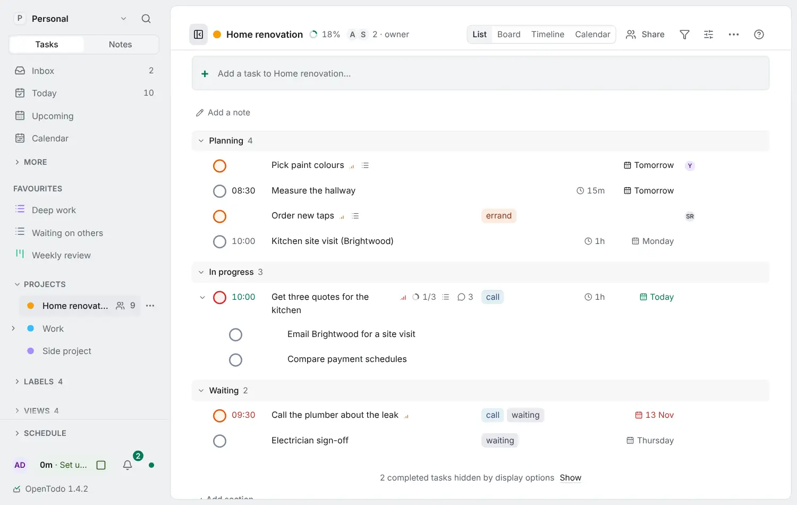
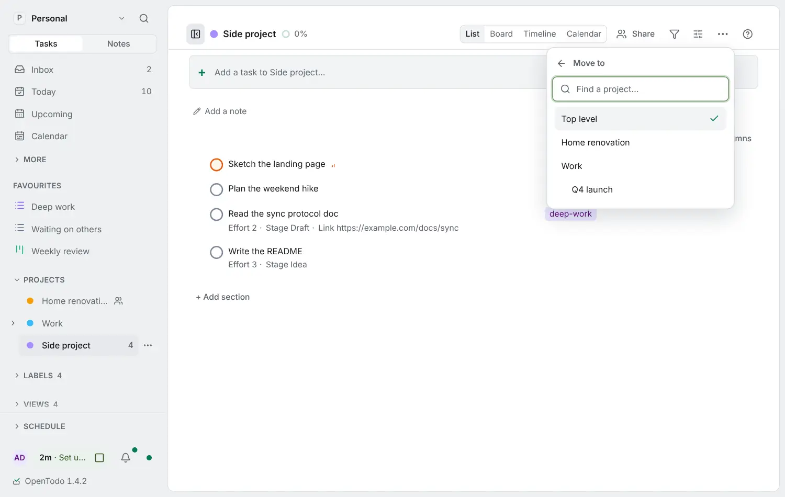

# Projects and sub-projects

<picture><source srcset="images/project-list-dark.webp" media="(prefers-color-scheme: dark)"></picture>

Projects keep related tasks together and can sit inside other projects.

## Organise with projects

To create a project, use **+** next to **Projects**. Enter a name, optionally pick a colour and icon with **Appearance**, then choose **Create**. Pick a parent for a sub-project. [Quick add](quick-add.md) inside a project puts tasks there. See [workspaces](workspaces.md).

The **Project** menu at the top right of a project lets you:

- pick a **colour**,
- **Pin to sidebar**, which adds it to **Favourites** (see below),
- **Move to…** another project, or back to the top level; <kbd>m</kbd> opens the menu straight at this step.
- **Rename** it,
- set **Icon…** for project names in lists and pickers, or **No icon** for the dot,
- choose a **Flow…** ([flows](project-flows.md)), **Review every…** or **Put in maintenance** ([intervals](review-intervals.md)),
- make it a [reusable list](reusable-lists.md) with **List…**,
- **Archive…** it: it and its sub-projects leave the sidebar, every task kept,
- **Delete project…**, which moves it to the Trash.

Archive and delete ask first.

<picture><source srcset="images/project-move-dark.webp" media="(prefers-color-scheme: dark)"></picture>

A project shows how much is done next to its title, as [All projects](all-projects.md) does.

A project's open-task count shows in the sidebar on hover or focus (always on touch, or with [every count on](sidebar-counts-and-order.md)). A folded project counts its sub-projects.

Inside a project you can also group tasks into sections and show them as a board: see [Sections and boards](sections-and-boards.md). Other groupings: [Group and order a list](group-and-order.md).

## All projects and favourites

**All** next to **Projects** in the sidebar (or <kbd>g</kbd> then <kbd>Shift</kbd>+<kbd>P</kbd>) opens the **Projects** page: every project in a table with its health and progress, and an **Archived** tab. See [All projects](all-projects.md).

**Pin to sidebar** adds a project, label or saved view to **Favourites**. Reorder it with **Move up**, **Move down** or <kbd>Alt</kbd>+<kbd>↑</kbd> / <kbd>↓</kbd>. Pins are personal and sync to your devices.

**⋯** on a sidebar project, or a right-click, opens its whole menu, **Share project** first. **Rename** is inline in **Projects**, a dialog in **Favourites**.

## Sub-projects

Sub-projects work like folders: "Work" can hold "Q4 launch". A project's page lists them; the arrow before one shows its tasks in place; its name opens it. Drop a task on one to move it. The sidebar folds them with <kbd>←</kbd> / <kbd>→</kbd>. The **+** menu next to **Projects** has **Collapse all**, **Expand all** and **Sort by name**; a project's menu has **Sort sub-projects by name**. Each sorts once, with Undo: "2" before "10". The magnifier (<kbd>g</kbd> then <kbd>/</kbd>) finds a project.

## Duplicate a project or task

**Duplicate…** in a project's menu makes a copy with the same sections, sub-projects and open tasks. Choose a parent and, optionally, a **Start on** day to shift every due date so the earliest lands on it. Completed tasks, comments, reminders and assignees aren't copied. You can duplicate any project you see; the copy is yours.

To duplicate one task with its open subtasks, select it and press <kbd>Shift</kbd>+<kbd>D</kbd>, or choose **Duplicate** in the task panel's **⋯** menu. The copy appears below it, selected, and syncs like any change. To reuse a project later, save it as a [template](import-export.md#templates).

## When a project is done

When you complete the last open task of a project, OpenTodo offers to archive it; press <kbd>Enter</kbd> to accept. Projects that have had no open tasks for 30 days are archived automatically, with a notice you can undo. Turn that off in **Settings → Data** (per device). To bring one back, use **Restore** in the **Archived** tab; see [Archived projects](archived-projects.md).
