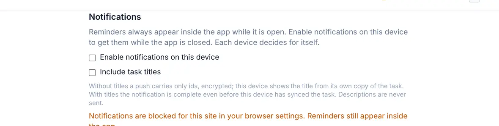

# Push notifications

<picture><source srcset="images/settings-notifications-dark.webp" media="(prefers-color-scheme: dark)"></picture>

Push notifications deliver [reminders](notifications.md) even when OpenTodo isn't open. Each device decides for itself.

## Get reminders when the app is closed

1. Open **Settings → Notifications** on the device.
2. Turn on **Enable notifications on this device** and allow notifications when the browser asks.
3. Select **Send test notification**. Your server sends a real push to this device, the same way it sends reminders, and a notification appears even while OpenTodo is open.

Repeat this on every device where you want them: your phone, your laptop, your tablet. Turning it off, or signing out, removes that device.

From a push notification you can **Snooze 10 min** or **Dismiss**, and that applies on all your devices.

Below the options, **Delivery check** lists everything push needs on this device and what the test found; see [Check that push works](push-delivery-check.md).

## On iPhone and iPad

Push needs iOS or iPadOS 16.4 or later, and only works in the installed app. Add OpenTodo to your home screen first ([Install on your phone](install-phone.md#iphone-and-ipad)), open it from there, then turn on notifications in its settings.

## Privacy

A push message goes through your browser's push service (run by the browser maker). It contains only an id and a time, encrypted so the push service can't read it. Your device then shows the title from its own copy of the task.

**Include task titles** puts the title in the encrypted message as well, so the notification can show it even before that device has synced the task. Notes are never sent. If your account uses [end-to-end encryption](e2ee.md), titles are never included.

## When notifications don't arrive

- **"Notifications are blocked in your browser settings"**: you said no when the browser asked. Allow notifications for your OpenTodo address in the browser's site settings, then select **Re-enable**.
- **"Push notifications are turned off on this server"**: the person running your server has switched push off. Reminders still show inside the app.
- **"This browser cannot receive push notifications"**: try the installed app, or open OpenTodo over `https://`.
- **The test says accepted but not received**: the push left your server but didn't reach this device. On a Mac, check **System Settings → Notifications** for your browser; on Windows, **Settings → System → Notifications**; on Android, the browser's or app's notification settings; on iPhone and iPad, the installed app's notification settings. Focus and do-not-disturb modes hide notifications too.
- **Nothing arrives on a phone**: check that the operating system allows notifications for the app (or the browser), and that battery saving or focus modes aren't holding them back.
- **Running OpenTodo from source with `make dev`**: development builds have no service worker, so push can't work there and the delivery check says so. Use the production build (`make run`, http://localhost:8080) to test push.

More fixes in [Troubleshooting](troubleshooting.md).
