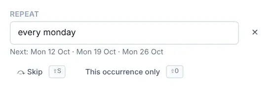

# Recurring tasks and reminders

Some tasks come back: pay the rent, water the plants, the weekly one-to-one. Make them repeat once and OpenTodo moves them forward each time you complete them. Add a reminder and you'll get a nudge when it matters.

## Make a task repeat

Open the task and type a rule into **Repeat**, such as `every week`. A list of suggestions appears as you type. Under the field you'll see the next three dates, so you can check the rule does what you meant.

<picture><source srcset="images/repeat-dark.webp" media="(prefers-color-scheme: dark)"></picture>

Rules are set in the task panel. Quick add doesn't read them: typing `every monday` there doesn't make a task repeat. Add the task first, then open it and set **Repeat**.

Repeating tasks show a ↻ symbol on the row. To stop repeating, select the **×** next to the rule.

## Rules you can write

| Rule | Repeats |
| --- | --- |
| `every day`, `every 3 days` | daily, or every few days |
| `every weekday` | Monday to Friday |
| `every week`, `every 2 weeks` | weekly or fortnightly |
| `every monday`, `every mon, wed, fri` | on those weekdays |
| `every month`, `every 15th` | monthly, on the same day or a fixed day |
| `every last day`, `every last friday` | at the end of the month |
| `every 2nd tuesday` | the second Tuesday of each month |
| `every year` | once a year on the same date |

Two extras work with any of these:

- **After completion:** `every 2 weeks after completion` counts from the day you actually finish, not from the due date. Good for things like "change the water filter".
- **An end:** add `until 2026-12-31` or `for 10 times` to stop the series.

Rules are in English, whichever language you use for dates in quick add. Every detail is in the [recurring task rules](recurrence.md) reference.

## Complete, skip or split off one occurrence

When you complete a repeating task, that occurrence is recorded in **Completed**, and the task moves to its next date. If it was overdue, it jumps to the next date from today, so missed occurrences don't pile up.

The buttons under the rule handle the exceptions:

- **Skip** (<kbd>Shift</kbd>+<kbd>S</kbd>) moves to the next date without recording a completion. Use it when this week's run is cancelled.
- **This occurrence only** (<kbd>Shift</kbd>+<kbd>O</kbd>) splits the current occurrence off as a normal task you can change freely, while the series moves on. Use it when this week's meeting is on Thursday instead.

Changing the title, notes, project, priority, labels or time of a repeating task changes the whole series.

## Add a reminder

Open a task and select **+ Add reminder** under **Reminders**. Choose one of:

- **At due time**, **10 minutes before**, **30 minutes before**, **1 hour before** or **1 day before**,
- **Custom offset…**, for any number of minutes, hours or days before or after,
- **At a specific date and time…**, for a fixed moment that doesn't depend on the due date.

<picture><source srcset="images/reminders-dark.webp" media="(prefers-color-scheme: dark)"></picture>

A task can have several reminders. Reminders relative to the due time move with it: change the due date and they follow, and on a repeating task they carry over to the next occurrence. If the task has a date but no time, "before" and "after" count from 09:00 that day.

## When a reminder goes off

While OpenTodo is open, a reminder pops up in the corner of the screen with **Snooze 10 min**, **1 hour**, **Tomorrow 09:00** and **Dismiss**. This works without a connection and without any permission.

To get reminders when the app is closed, turn on notifications for each device in **Settings → Notifications**. On an iPhone this needs the installed app. See [Notifications](notifications.md).

Snoozing or dismissing on one device applies to all of them.

## Shared projects

Reminders are personal. On a task in a shared project, your reminders are yours alone: other members don't see them and don't get them. You can add reminders even if you can only view the project.

## Tips

- For bills, use a day-of-month rule (`every 1st`) plus a **1 day before** reminder.
- A reminder on a task without a time fires at 09:00 for "at due time". Give the task a time if you need it earlier.
- Deleted tasks don't remind you. If you restore one, its reminders come back.
