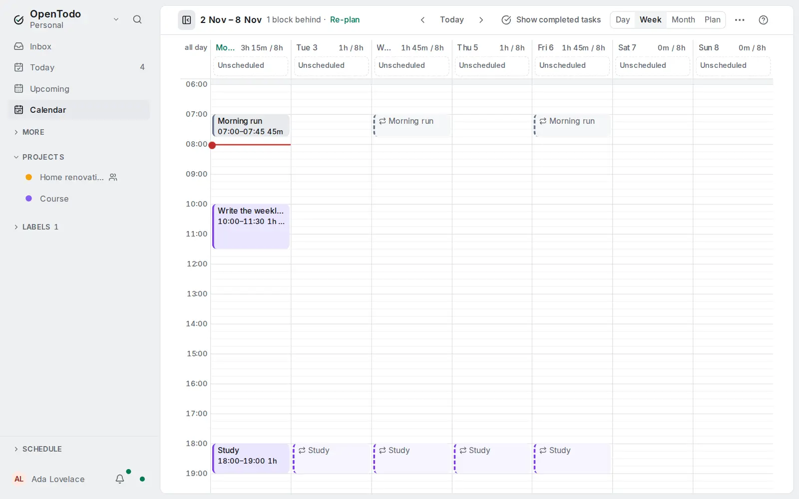

# Repeating tasks on the calendar

<picture><source srcset="images/repeating-calendar-dark.webp" media="(prefers-color-scheme: dark)"></picture>

## See repeating tasks ahead

A repeating task stands on its current date, and the dates after it are drawn as faint
blocks and rows with a dashed edge and the repeat icon, so next Tuesday's study session
or Friday's habit is already on the grid.

- **Day and Week:** a timed occurrence is a block at its time, as tall as the task's
  estimate; one without a time is in the day's **Unscheduled** lane. On a phone's Week
  they follow each day's tasks.
- **Month:** they are rows of their day, in order with its tasks, and count in
  **+N more**. On a phone the count on each day counts tasks only; the day's list
  shows them after its tasks.
- **Capacity:** each day's planned total adds their estimates, and its tooltip names
  them ("45m repeating").
- They can't be dragged, completed or selected with <kbd>j</kbd> and <kbd>k</kbd>.
  Tab reaches them, and a click or <kbd>Enter</kbd> opens the task with the date
  named under its title. The calendar's [filter](calendar-filter.md), Colour by and a
  project's Calendar layout apply to them as to their task.
- Turn them off with **Show repeating occurrences** in the calendar's **More actions**
  menu. Each device keeps its own choice; the Plan always shows them, as its bar counts them.

**Upcoming** has the same item in its menu, off by default. Turned on, it lists the
coming occurrences of the next 14 days under their days, after each day's tasks, and
the last of them says up to which date they are shown. They are not counted in
Upcoming's numbers. How the dates are worked out: [Recurring task rules](recurrence.md#projected-occurrences).
