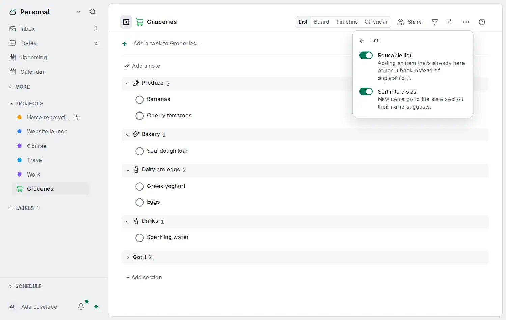

# Sort a list into aisles

<picture><source srcset="images/reusable-list-menu-dark.webp" media="(prefers-color-scheme: dark)"></picture>

A [reusable list](reusable-lists.md) can sort new items into the sections of a supermarket, so the list is in the order you walk the shop.

## Turn it on

With **Reusable list** on, the **List…** step also offers **Sort into aisles**. Turning it on asks once whether to add the aisle sections the list does not have yet: Produce, Bakery, Dairy and eggs, Meat and fish, Frozen, Pantry, Drinks, Household and Personal care, named in your app language. Choose **Add sections**, or **Not now** to keep your own sections.

A new item then goes to the aisle section its name suggests. "Greek yoghurt" goes to Dairy and eggs, "Bananas" to Produce. The words come from a list built into the app for each app language, with English as a fallback, and never leave your device.

- Each aisle section remembers its aisle, so you can rename it ("Fridge"), move it or give it another icon and items still find it. Members using another language find it too.
- An item reopened from **Got it** stays in the section it was in. Move "Oat drink" to another section once and it comes back there.
- An item whose words are not in the list goes where quick add puts it today: the section you are adding to, or **No section**.
- Adding inside a section, from its own **+**, always puts the item there.

Items added through the API, the CLI or an AI assistant are not sorted into aisles; they can name a section themselves.

## From the API, the command line and AI assistants

- `POST /api/v1/tasks` takes `"reuse": true`. In a reusable list the server reopens a ticked match (status 200, `"reused": "reopened"`), returns an open match (200, `"reused": "open"`), or creates the task as usual (201). See [the API](api.md#reusable-lists).
- `ot add` asks for this whenever the project is a reusable list and says "reopened" or "already on the list"; `--new` adds another. `ot project edit <project> --reusable --aisles` turns the mode on. See [the command line](cli.md).
- The MCP `create_tasks` tool reopens or reports items the same way, and `update_project` takes `reusable` and `aisles`. See [MCP](mcp.md).
