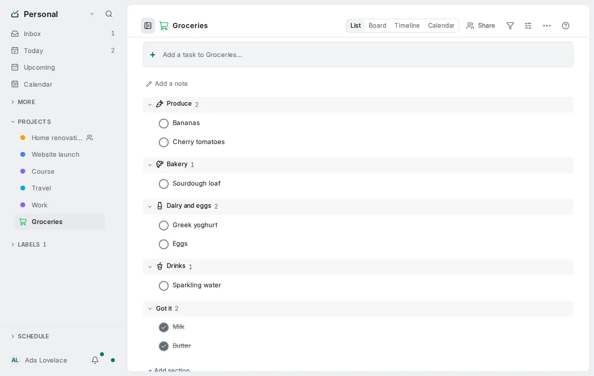

# Reusable lists

<picture><source srcset="images/reusable-list-dark.webp" media="(prefers-color-scheme: dark)"></picture>

Some lists come back every week: groceries, the pharmacy, packing. Make such a project a **reusable list**:

- Adding an item that is already there brings it back instead of creating a second one.
- Ticked items stay at the end of the list, in a **Got it** group, on every member's devices.
- New items can [sort themselves into aisles](reusable-list-aisles.md).

## Turn it on

Open the **Project** menu at the top right of the project and choose **List…**. Turn on **Reusable list**. The setting is synced to everyone who shares the project. Editors, admins and the owner can change it; viewers cannot.

Turning it off changes no items; completed tasks follow your **Show completed tasks** choice again (see [Completed tasks in a project](completed-in-projects.md)).

## Adding an item that is already there

When you add an item from [quick add](quick-add.md), the list looks for an item with the same name:

- **A ticked item** is reopened where it is, in its section, with its notes and labels. A date, priority or label you typed with it is added. The message reads "Milk is back on the list", with **Undo**.
- **An open item** is left as it is and flashes once. The message reads "Milk is already on the list".

Either message offers **Add anyway**, which adds a new item as an ordinary add would. The message stays for four seconds.

Names match when they are the same apart from upper and lower case, accents, spaces at the ends, double spaces and one full stop at the end. So "CAFE" matches "Café", and "milk " matches "Milk". Nothing else matches: "Mlik" is a new item, and "Strasse" does not match "Straße". Subtasks never match.

When you paste several lines, each line follows the same rule, and one message counts what came back, what was already there and what was added.

This works offline: the list is matched on your device.

## Ticked items: Got it

A reusable list always ends with a **Got it** group holding its ticked items, newest first, on every device. The board and the timeline show open items only. The group starts closed; click its heading to open it. Untick an item there, or add it again, and it is back on the list. The Project menu has no **Show completed tasks** here.

## When two people add the same item

If two phones add "Eggs" while offline, the list has two Eggs once both sync. The next device that can edit the list keeps one and moves the other to the [Trash](trash-and-history.md); every device picks the same one, so the list settles on one Eggs. The project's activity shows the removal as "merged a duplicate", and you can restore it from the Trash.

An item with anything of its own is never removed this way: notes, subtasks, comments, attachments, reminders, tracked time or a repeat. Both items then stay, and you decide.

## Encrypted accounts

With [end-to-end encryption](e2ee.md), item names are encrypted, so the server cannot match them. Adding from the app still works, because your device matches the names. An add through the API creates a new item, and the next device that sees the duplicate merges it as described above.

The API, the command line and AI assistants reuse items too: see [Sort a list into aisles](reusable-list-aisles.md#from-the-api-the-command-line-and-ai-assistants).
