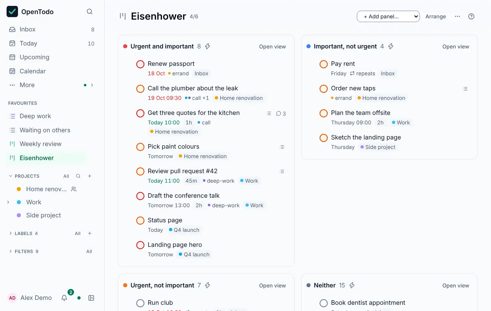

# Saved views

<picture><source srcset="images/filter-dark.webp" media="(prefers-color-scheme: dark)"></picture>

When the built-in views aren't enough, describe the tasks you want with a filter query and save the result as a view of your own. A view's menu can [make an automation rule](automations.md#turn-a-filter-into-a-rule) from it.

## Save your own views

Describe what you want on the **New view** page (<kbd>g</kbd> <kbd>f</kbd>), then save it. For example, `blocked` lists every task waiting for another one, and `due <= 7 days & p1` shows urgent tasks for the coming week. Build the query from conditions or type it: see [Labels and filters](labels-and-filters.md), and [Filter queries](filters.md) for ten examples.

To save it, press <kbd>s</kbd> in the results or choose **Save as view**, type a name in the card that replaces the header and press <kbd>Enter</kbd>. The view keeps its display options, is listed in the **Views** group of the sidebar, pinned to **Favourites**, and synced to all your devices. Its live count is on the views list (<kbd>g</kbd> <kbd>v</kbd>), in its header and, with [every count on](sidebar-counts-and-order.md), in the sidebar.

## Conditions and display options

Under a view's header (**Views › name**), the toolbar shows its conditions in words, such as **Label is waiting**. The funnel opens the filter panel to change them (<kbd>/</kbd> jumps to the query). **Display options** sets **List** or **Board**, the grouping and order, whether completed tasks are listed, and which properties rows show; each choice is saved to the view and syncs. [Filter queries](filters.md#saving-views) has every option.

The **All** link next to **Views** (or <kbd>g</kbd> <kbd>v</kbd>) opens the list of all your saved views and boards to rename, reorder, pin or delete them.

Every saved view has the same menu, wherever you open it: the **⋯** button on its row in the sidebar or the views list, its header, or a dashboard. With a row focused, <kbd>.</kbd> (or <kbd>Shift</kbd>+<kbd>F10</kbd>) opens it too.

- **Rename**.
- **Icon…**, picked as for projects.
- **Pin to sidebar** and **Start view on this device**: a check mark shows which apply. **Pin to sidebar** adds the view to **Favourites** or takes it out; it stays in the **Views** group either way.
- **Move up** and **Move down**: unavailable at the top or bottom of the list, with the reason shown. Opened from **Favourites**, they move the view among your favourites.
- **Delete view…** asks for confirmation first. Deleting a view never touches your tasks.

<picture><source srcset="images/view-menu-dark.webp" media="(prefers-color-scheme: dark)"></picture>

## Build a dashboard

A dashboard (a board) puts up to six saved views side by side, each with its count and first ten tasks: "Due this week" and "Waiting on others" for a morning review.

<picture><source srcset="images/dashboard-dark.webp" media="(prefers-color-scheme: dark)"></picture>

Open the views list (<kbd>g</kbd> <kbd>v</kbd>), choose **New board**, then **Empty board**, name it, then add saved views as panels from the dashboard's header. Panels stack on a phone. Move between panels with <kbd>Tab</kbd>, and through a panel's tasks with <kbd>j</kbd> / <kbd>k</kbd>.

### Sort work by dropping cards

In **Arrange**, choose **Rule** next to a panel to set what a dropped card gets: labels added or removed, a priority, a date (today, tomorrow, next week or none), Someday, a section, completed or reopened. A bolt marks a column with a rule; others take no drops.

Drag a card onto a column, or press <kbd>Shift</kbd>+<kbd>→</kbd> / <kbd>Shift</kbd>+<kbd>←</kbd> to move the selected card to the next column with a rule. A message names the changes, with Undo. A card that still doesn't match the column's filter stays there, marked **Not matching**, until you leave the board.

**New board** also offers the **Eisenhower matrix**: four filters by priority and date, **Urgent and important** to **Neither**, each with a rule.

<picture><source srcset="images/eisenhower-dark.webp" media="(prefers-color-scheme: dark)"></picture>

Each device can open on a saved view or a dashboard: see [Choose where the app opens](views.md#choose-where-the-app-opens).
