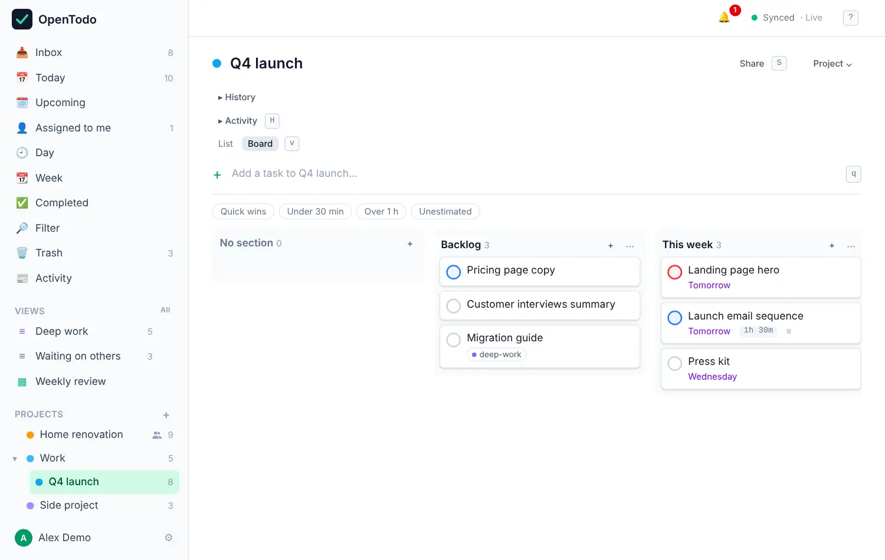

# Sections and boards

Sections divide a project into parts, like "Planning", "In progress" and "Waiting", or "Kitchen", "Bathroom" and "Garden". The same project can be shown as a list with headings or as a board with one column per section.

## Add a section

Open a project and select **+ Add section** at the bottom of the list. Type a name and press <kbd>Enter</kbd>. You can add the next one straight away.

<picture><source srcset="images/project-list-dark.webp" media="(prefers-color-scheme: dark)"></picture>

Each heading shows how many open tasks it holds. Tasks without a section are listed first under **No section**.

## Add tasks to a section

Select the **+** on a section heading and type: the task goes straight into that section. You can also open any task and choose a **Section** in its panel.

## Rename, reorder or delete a section

Use the **⋯** menu on a section heading:

- **Rename**
- **Move** it up or down (left or right on the board)
- **Delete section**. Its open tasks aren't deleted; they move to **No section**.

Fold a section with the small arrow next to its name. Folding is remembered on that device only.

## Switch to a board

At the top of the project, choose **Board** (or press <kbd>v</kbd>). Each section becomes a column, with **No section** first. Press <kbd>v</kbd> again, or choose **List**, to switch back.

<picture><source srcset="images/board-dark.webp" media="(prefers-color-scheme: dark)"></picture>

The choice is remembered for each project on each device. Your laptop can show "Q4 launch" as a board while your phone shows it as a list. On a narrow screen the board scrolls sideways.

## Move cards between columns

- **Drag** a card to another column, or to a place within a column. On a touch screen, press and hold the card first.
- **Keyboard:** select a card and press <kbd>Shift</kbd>+<kbd>→</kbd> or <kbd>Shift</kbd>+<kbd>←</kbd>. The card stays selected, so you can keep moving it.
- **Panel:** open the task and pick another **Section**.

Moving with the keyboard or the panel puts the card at the bottom of the new column.

## Get around the board with the keyboard

| Key | Does |
| --- | --- |
| <kbd>h</kbd> / <kbd>l</kbd> or <kbd>←</kbd> / <kbd>→</kbd> | Jump to the previous or next column |
| <kbd>j</kbd> / <kbd>k</kbd> | Move up and down within a column |
| <kbd>Shift</kbd>+<kbd>←</kbd> / <kbd>Shift</kbd>+<kbd>→</kbd> | Move the selected card to the previous or next column |
| <kbd>a</kbd> | Add a task to the selected card's column |
| <kbd>Enter</kbd> | Open the card |

## Good to know

- Moving a task to another project removes it from its section, because sections belong to one project.
- If someone deletes a section while you were moving a task into it on another device, the task ends up under **No section**. Nothing is lost.
- Sections are part of the export and come back when you import it.

## Ideas for sections

- A simple flow: **To do**, **Doing**, **Done**.
- By place: **Kitchen**, **Bathroom**, **Garden** for a renovation.
- By week: **This week**, **Next week**, **Later** for a launch plan.
