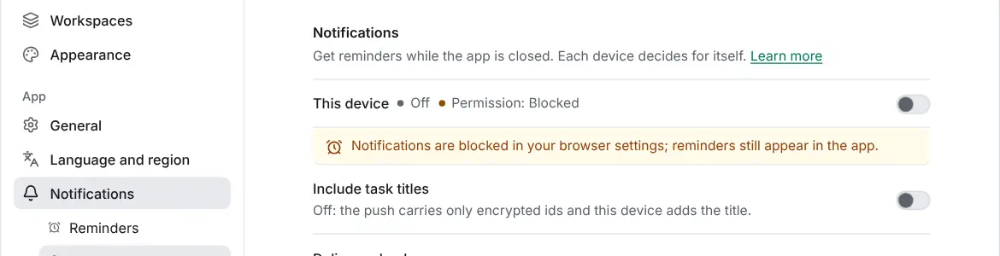

# Settings: App

<picture><source srcset="images/settings-notifications-dark.webp" media="(prefers-color-scheme: dark)"></picture>

The **App** group of [Settings](settings.md) is about how the app behaves. Settings marked "this device" belong to the device you're on; the others follow your account.

## General

- **Start view and briefing**: the view this device opens on, including **Display: Today** and **Display: Upcoming** for a wall panel. See [Views](views.md#choose-where-the-app-opens) and [Display mode](display-mode.md). **Show the briefing**: the sentence under Today's title.
- **Keyboard** (this device) · **Show shortcut hints**, **Single-key shortcuts** (turn off for voice input) and **Vim keybindings**. See [Keyboard shortcuts](keyboard.md#vim-keybindings). **Click a task to** has moved to **Appearance → Task details** (below). **Show details** still [expands a row](expand-a-row.md).
- **Focus timer**: the [Focus](focus.md) timer's lengths, breaks, sound, presets and noise (noise volume is per device).
- **Priorities**: [your names](priorities.md) for each level.
- **Maps**: maps and address search on your devices, if the owner allows. See [Locations and places](locations-and-places.md).

### Click a task to

In **Appearance → Task details**, for your account on every device:

- **Use the server default**: the owner's choice in **Server → Task lists**, named in brackets.
- **Select, then edit the title**: a click selects, a second click on the title [edits it](task-panel.md).
- **Open details**: a click opens the task and never edits; <kbd>F2</kbd> still does.

## Language and region

All following your account:

- **Language**: the language of the app. See [The app in your language](language.md).
- **Date and time**: how dates and times look and where weeks start (see below).
- **Calendar grid**: the Day and Week grid's hours, your day length, and whether meetings count toward it. See [Time blocking](time-blocking.md#adjust-the-grid).

### Date and time

Four choices that follow your account to every device:

- **Date format**: **System** (the way this browser writes dates), **Day-month** (`14 Oct`, `14/10/2026`), **Month-day** (`Oct 14`, `10/14/2026`) or **ISO** (`2026-10-14`). Month and weekday names are written in the [interface language](language.md).
- **Time format**: **System**, **12-hour** (`3:00 PM`) or **24-hour** (`15:00`).
- **Week starts on**: **System**, **Monday**, **Sunday** or **Saturday**. It decides where the Week view and the calendar of a date field start, and which days `this week` and `last week` cover in [filters](filters.md#periods).
- **My day starts at**: **Midnight** (the default) or a time up to 06:00. If you work past midnight, set it to when your day really ends: until then the app still treats it as the previous day. See [When a day ends](dates-and-times.md#when-a-day-ends).

The **Sample** shows how dates and times will look. A change applies at once everywhere in the app, without a reload. With a numeric date order on **Automatic**, quick add reads dates like `3/11` in your date format too.

## Notifications

**Push notifications** for reminders on this device, and a test that shows whether they arrive. See [Notifications](notifications.md) and [Push notifications](push-notifications.md). **Delivery channels**: [ntfy, Pushover, Gotify or a webhook](notification-channels.md).

**Weekly digest**: an email on the day you choose with last week's numbers; it needs outgoing email from the server owner. See [the weekly digest](statistics.md#weekly-digest-by-email).

## Capture

- **Quick add**: turn natural-language parsing on or off, and pick the languages it understands. Dates like `12/11` follow your date format. See [Quick add syntax](quick-add.md#languages).
- **Voice capture**: dictate tasks into quick add. Off until you turn it on, and the app explains first what your browser does with the audio. See [Quick add syntax](quick-add.md#voice).
- **Bookmarklet and extension**: the **Add to OpenTodo** bookmarklet, to save the page you're reading as a task. See [Capturing pages](capture.md).
- **Email to task**: your own secret address; an email sent there becomes an Inbox task. Keep it private: **New address** replaces it at once. See [Email to task](email.md).
