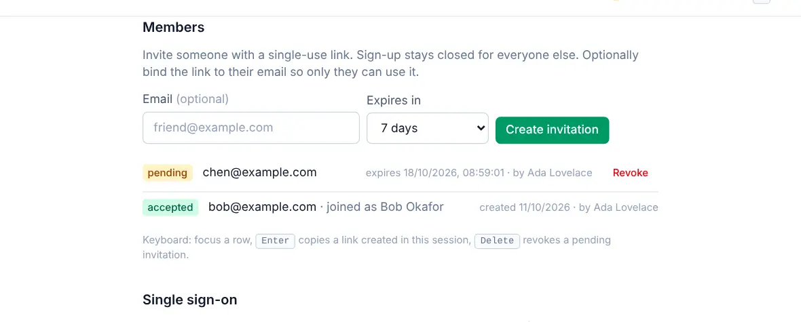

# Settings: Server

<picture><source srcset="images/members-dark.webp" media="(prefers-color-scheme: dark)"></picture>

The **Server** group of [Settings](settings.md) is for the people who run the server. Only the owner and admins see it; **Server** and the access policies inside **People** are for the owner only.

## People

- **Users**: everyone with an account, their role and last sign-in. Make someone an admin (owner only; admins manage members), deactivate or reactivate an account, reset a password, or delete an account. When the server sends email, a reset offers **Send reset email** (the link goes straight to the person; you never see it) beside **Create reset link** (you deliver the link yourself).
- **Members**: invite people with a single-use link. With outgoing email, **Send by email** mails it to the address you enter. See [Invite people](invite-people.md#invite-someone-new).
- **Two-factor policy** (owner only): optional, required for the owner, or required for everyone. An account that must use it and has not set it up can still sign in, but can only set it up until it does; API tokens are never affected. See [Two-factor authentication](two-factor.md).
- **Single sign-on** (owner only): sign-in through an OpenID Connect provider you already run, such as Authentik, Keycloak or Authelia; the server contacts only the issuer you enter. See [Single sign-on](self-hosting/sso.md).
- **Project invite links** (owner only): **Invite new people** (off by default) lets links that members create in a project's Share dialog also create accounts; links from you or an admin always can. It applies to links already handed out too, since links are checked when used. See [Who can bring new people](sharing.md#who-can-bring-new-people).

## Server

- **Backups**: scheduled backups of the whole server (every account, task and the sync log) to a folder, S3 or WebDAV, the last run and its result, and the next one. **Restore from a backup** puts the whole server back to an archive from the destination or one you upload: you see a verified preview first, type `RESTORE` to confirm, and the server restarts into the restored data. **Undo last restore** puts the previous database back, and old safety copies can be deleted to free space. See [Backups](backups.md#restore-from-the-web-app).
- **Attachments**: turn attachments on or off, and set the size per file (25 MB unless changed, up to 2048 MB) and the total per account (1 GB unless changed; 0 means no total). See [Attachments](attachments.md#limits).
- **Outgoing email**: the SMTP server this server sends mail through, for password resets, sign-up confirmations and invitations; nothing is sent until it is configured. The card shows whether it's configured, the server and From address, and the last test. **Configure** opens the form, where fields set by `OPENTODO_SMTP_*` variables are read-only. **Send test email** sends a message to you and shows the mail server's answer when it fails. See [Outgoing email](self-hosting/outgoing-email.md).
- **Audit log**: sign-ins, tokens, invitations, exports and setting changes, and who made them; task content is never recorded. Recording client addresses is off by default, turning it off erases every stored address, and behind a reverse proxy the address comes from `X-Forwarded-For`.

On a hosted service the provider runs backups, attachment limits, outgoing email and single sign-on, so those cards are hidden. **Download your data** gives the owner the whole server (every account, project, task, comment, file and setting) as one backup archive instead: restore it into a server of your own with `opentodo restore`, and devices then sync with the new address. Keep it private: it holds every account's sign-in data. See [Host mode](self-hosting/host-mode.md#owners-take-their-data-away).

Running the server itself is covered in [Running with Docker](self-hosting/docker.md).
