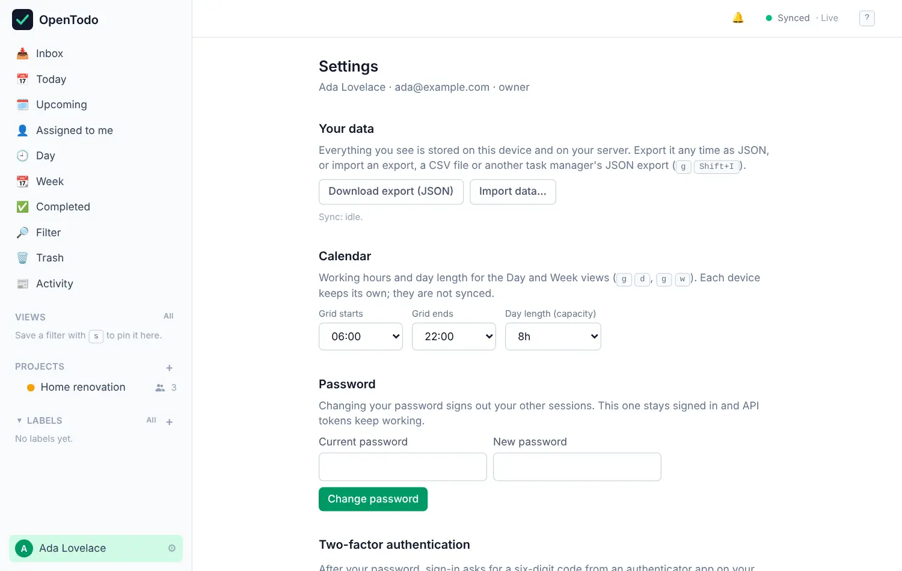

# Settings

<picture><source srcset="images/settings-dark.webp" media="(prefers-color-scheme: dark)"></picture>

Open **Settings** from the menu of your name at the bottom of the sidebar, or press <kbd>g</kbd> then <kbd>s</kbd>. On a wide screen the sections are listed on the left with **Account** open beside it; on a phone each level is its own page with a back link. The list starts with your profile card and **Search settings**, then the sections grouped under **You**, **App**, **Data** and, for the people who run the server, **Server**.

Longer sections open as a short list of their pages, each row with its state in a word ("Webhooks · 2", "Calendar feeds · Off"). A row opens its page, such as **Integrations › Webhooks**.

**Search settings** finds a setting by name or by what it does; matches are listed under their section, and Enter opens the page that holds the first one, scrolled to it and briefly highlighted. The command palette (<kbd>Ctrl</kbd>/<kbd>⌘</kbd>+<kbd>K</kbd>) searches the same index: "passkey" lists **Account › Passkeys**.

Every section and page has its own address, such as `/settings/integrations/webhooks`, to bookmark or share. Older links still work.

On a page, each group of settings leads with a heading and one sentence, then rows: label and description on the left, the control on the right (below it on a narrow screen). Forms open from a button; removing something asks you to confirm first.

Some settings follow your account to every device; others belong to the device you're on, marked "this device", so your phone and laptop can differ. Each page's **Help** button opens its part of this guide beside it.

The owner and admins also see **People**; the owner alone sees **Server**. On the public demo every section is listed, and the rows the demo refuses have their controls disabled, under a note at the top of the page naming them.

## You

Your account and how the app looks for you: [Settings: You](settings-you.md).

### Account

[Account](settings-you.md#account): **Profile**; **Security** with your password, two-factor authentication, passkeys, linked accounts and **Sign out here**; **Recent activity**; and **End-to-end encryption**.

### Appearance

[Appearance](settings-you.md#appearance): **Theme and density** (System, Light or Dark, one of eight colour themes, density) and **Sidebar** (which **More** destinations it shows), all following your account.

## App

How the app behaves: [Settings: App](settings-app.md).

### General

[General](settings-app.md#general): **Start view and briefing**, **Keyboard**, **Focus timer** and **Maps**.

### Language and region

[Language and region](settings-app.md#language-and-region): the [language](language.md), [date and time](settings-app.md#date-and-time) (formats, first day of the week, when your day starts) and the calendar grid, on all your devices.

### Notifications

[Notifications](notifications.md): [default reminders](default-reminders.md), **Push notifications** for reminders on this device with a test, **Delivery channels** such as ntfy, and the [weekly digest](statistics.md#weekly-digest-by-email).

### Capture

[Capture](settings-app.md#capture): quick add parsing and its languages, voice capture, the bookmarklet and extension, and email to task.

### About

[About](feedback-and-support.md#settings--about): version, docs, feedback and support.

## Data

Connections to other tools, and your data: [Settings: Data](settings-data.md).

### Integrations

[Integrations](settings-data.md#integrations): one page each for calendar apps (CalDAV), calendar feeds, issues, webhooks, API tokens, the in-app assistant and AI assistants over MCP.

### Data

[Data](settings-data.md#data): export and import, attachments, the sync status of this device, and archiving and restoring projects.

## Server

Owner and admins only; **Server** and the access policies inside **People** are for the owner alone. Every row: [Settings: Server](settings-server.md).

### People

[People](settings-server.md#people): **Users and invitations**, **Access policies** (two-factor, project invite links) and **Single sign-on**.

### Server

[Server](settings-server.md#server): one page each for backups, attachments, outgoing email, branding, maps, automations, speech to text and the audit log. Running the server: [Running with Docker](self-hosting/docker.md).
