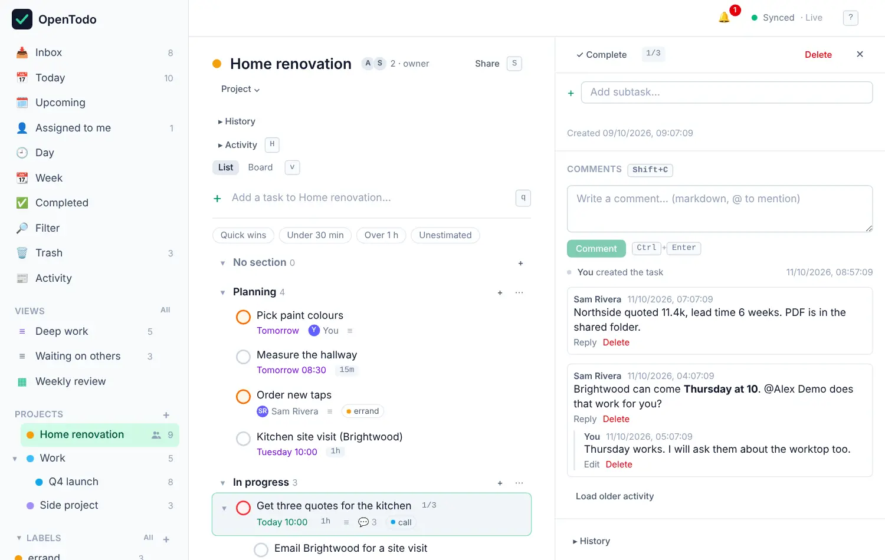
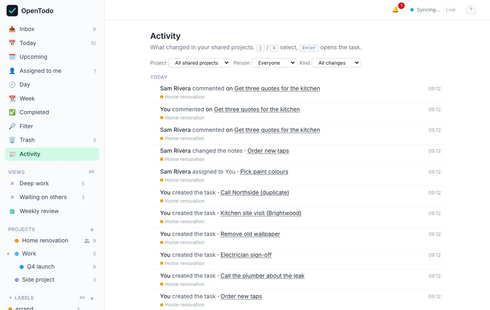

# Sharing and comments

Projects can be shared with other people who have an account on the same OpenTodo server: your partner for the house move, your team for a launch. Everyone sees the same tasks, edits sync to everyone within seconds, and each task has a comment thread.

## Share a project

1. Open the project and select **Share** at the top (or press <kbd>Shift</kbd>+<kbd>S</kbd>).
2. Type the person's email address.
3. Pick a role and select **Share**.

<picture><source srcset="images/share-dialog-dark.webp" media="(prefers-color-scheme: dark)"></picture>

The project appears on their devices the next time they sync, with all its tasks. Shared projects have a small people icon in the sidebar.

You can only add people who already have an account on your server. If they don't, invite them first (see below).

## Choose a role

| Role | Can |
| --- | --- |
| **viewer** | see the project and its tasks, and comment |
| **editor** | also add, edit, complete and delete tasks, and assign them |
| **admin** | also rename, recolor and archive the project, and manage members |
| **owner** | everything, including deleting the project and handing it over |

Every project has exactly one owner. To change someone's role, open **Share** and pick a new one next to their name. **Remove** takes them out of the project.

For viewers, the project is read-only: the add box and edit controls are switched off, with a note saying so.

## Invite someone new

Sign-up on an OpenTodo server is closed by default, so new people join with an invitation. If you're the owner or an admin of the server, go to **Settings → Members**, optionally enter their email, choose how long the link stays valid, and select **Create invitation**. Copy the link and send it to them however you like; OpenTodo doesn't send emails. The link works once.

<picture><source srcset="images/members-dark.webp" media="(prefers-color-scheme: dark)"></picture>

If you're not an admin of the server, ask whoever runs it to invite the person. Once they've joined, you can share projects with them yourself.

## Leave or hand over a project

- **Leave**: in the Share dialog, select **Leave** next to your own name. The project disappears from your devices; everyone else keeps it.
- **Make owner**: the owner can hand the project to another member. The previous owner becomes an admin. Owners can't leave until they've done this.

When someone leaves or is removed, tasks assigned to them become unassigned.

## Assign tasks

In a shared project, each task can be assigned to one member. Open the task and choose someone under **Assignee**, or select the task and press <kbd>Shift</kbd>+<kbd>A</kbd>, type a name and press <kbd>Enter</kbd>. The assignee's avatar shows on the row, and they get a notification.

**Assigned to me** in the sidebar (<kbd>g</kbd> <kbd>a</kbd>) lists every open task assigned to you, across projects.

## Comment on a task

Open a task and scroll to **Comments**, or press <kbd>Shift</kbd>+<kbd>C</kbd> with the task open. Write your comment and post it with **Comment** or <kbd>Ctrl</kbd>+<kbd>Enter</kbd> (<kbd>⌘</kbd>+<kbd>Enter</kbd> on a Mac).

<picture><source srcset="images/comments-dark.webp" media="(prefers-color-scheme: dark)"></picture>

- **Mention** someone by typing `@` and picking their name. They get a notification.
- **Reply** to a comment to keep a conversation together. Replies are nested under it.
- **Edit** or **Delete** your own comments. Edited comments are marked as edited. Project admins and the owner can delete any comment.
- Comments support simple formatting: `**bold**`, `*italic*`, `` `code` ``, lists, quotes and links.

Everyone who can see a task can comment on it, viewers included. Rows with comments show a speech bubble and a count. Comments work offline too and are sent when you're back online.

The same thread shows the task's activity: who created it, completed it or changed its date.

## See what others changed

**Activity** in the sidebar (<kbd>g</kbd> <kbd>h</kbd>) lists the latest changes in all your shared projects, newest first and grouped by day. Each shared project shows a count of unread changes next to its name, and opening the feed marks them as seen. Filter by project, person or kind of change (completed, created, commented, assigned, rescheduled).

<picture><source srcset="images/activity-dark.webp" media="(prefers-color-scheme: dark)"></picture>

Inside a project, **Activity** at the top (<kbd>Shift</kbd>+<kbd>H</kbd>) shows the changes for that project only.

## Things to know

- **Labels and reminders stay personal.** Labels you add to a shared task are only visible to you, and so are your reminders.
- **Moving a task out of a shared project** to your own project or Inbox makes a copy there and removes the original from the shared project for everyone.
- **Deleting a shared project** is something only the owner can do. It disappears for every member, and its open tasks are copied into the owner's Inbox.
- **End-to-end encryption and sharing don't mix.** Shared projects are never encrypted, and an account with [encryption](e2ee.md) turned on can't share new projects.
