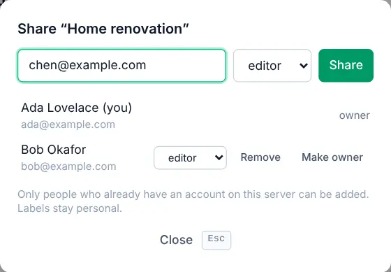

# Sharing and comments

<picture><source srcset="images/share-dialog-dark.webp" media="(prefers-color-scheme: dark)"></picture>

Share a project with people who have an account on the same OpenTodo server: your partner for the house move, your team for a launch. Everyone sees the same tasks, edits sync within seconds, and each task has a comment thread.

## Share a project

1. Open the project and select **Share** at the top (or press <kbd>Shift</kbd>+<kbd>S</kbd>).
2. Type the person's email address.
3. Pick a role and select **Share**.

The project appears on their devices the next time they sync, with all its tasks. Shared projects show a people icon in the sidebar.

Email works only for people with an account on your server; anyone else gets an invite link (next section).

## Invite with a link

An invite link adds one person to the project, with or without an account. In **Share**, select **Create a link…**, pick a role, optionally an email and an expiry, then copy it and send it yourself. It is shown once and works once; the dialog lists and revokes waiting links. See [Invite people](invite-people.md#invite-with-a-link).

### Who can bring new people

A link creates a new account only when its creator is the owner or an admin of the server, open sign-up is on, or the server owner switched on **Invite new people** (**Settings → People → Project invite links**). See [Who can bring new people](invite-people.md#who-can-bring-new-people).

## Share with a public link

A public link shows a project's open tasks to anyone with it, no account needed, view-only or with ticking, also [full screen on a display](public-links.md#show-it-on-a-display); a **Public** badge marks the project. See [Public links](public-links.md).

## Choose a role

Viewers see the project and comment, editors also change tasks and the project's note, admins also manage the project and its members, and the one owner can also delete or hand it over. Change roles next to a name in **Share**; **Remove** takes someone out. See [Roles and assignments](roles-and-assignments.md#choose-a-role).

## Invite someone new

Sign-up is closed by default. An invite link is the quickest way in; the owner or an admin of the server can also create a server invitation under **Settings → People → Members**. See [Invite people](invite-people.md#invite-someone-new).

## Leave or hand over a project

**Leave** next to your name in **Share** takes the project off your devices; everyone else keeps it. The owner hands it over with **Make owner** first. See [Roles and assignments](roles-and-assignments.md#leave-or-hand-over-a-project).

## Assign tasks

In a shared project, a task is assigned to one member under **Assignee** or with <kbd>Shift</kbd>+<kbd>A</kbd>; **Assigned to me** (<kbd>g</kbd> <kbd>a</kbd>) lists everything assigned to you. See [Roles and assignments](roles-and-assignments.md#assign-tasks).

## Comment on a task

Every task has a comment thread under **Comments**, with @mentions, replies and simple formatting; everyone who can see the task can comment, offline too. See [Comments and activity](comments-and-activity.md#comment-on-a-task).

## See what others changed

**Updates** (<kbd>g</kbd> <kbd>h</kbd>) lists the latest changes in all your shared projects; **Activity** inside a project shows its changes only. See [Comments and activity](comments-and-activity.md#see-what-others-changed).

## Things to know

- **Labels and reminders stay personal.** Only you see the labels and reminders you add to a shared task.
- **Moving a task out of a shared project** to your own project or Inbox makes a copy there and removes the original for everyone.
- **Only the owner deletes a shared project.** It disappears for every member; its open tasks go to the owner's Inbox.
- **End-to-end encryption and sharing don't mix.** Shared projects are never encrypted, and an account with [encryption](e2ee.md) on can't share new projects.
