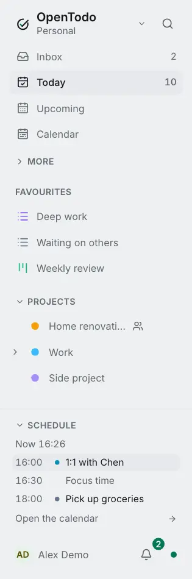

# Schedule in the sidebar

<picture><source srcset="images/sidebar-schedule-dark.webp" media="(prefers-color-scheme: dark)"></picture>

When a task is open beside a list, it's easy to lose track of the time and of what comes next. **Schedule**, at the bottom of the sidebar, keeps today in sight without switching to the calendar.

## Open it

Click **Schedule** above your name at the bottom of the sidebar. It stays open or closed on this device as you leave it. It isn't shown while the sidebar is folded into icons, or on a phone, where **Today** is in the tab bar.

## What it shows

- The time now.
- Today's tasks with a time, and timed events from your [subscribed calendars](calendar-feeds.md), that haven't ended yet, in order. The one already under way is highlighted.
- Up to five of them. **N more today** opens the [Day calendar](calendar-views.md) with the rest; when everything fits, the link reads **Open the calendar**.

Tasks without a time and all-day events stay in [Today](calendar-events-in-today.md) and the calendar.

## Use it

- Click a task to open it in the side panel, next to the list you're in.
- Click an event to see its details.
- To move or resize a block, use the Day or Week calendar.

It works offline: tasks are on your device, and events show from the last copy your device fetched.
