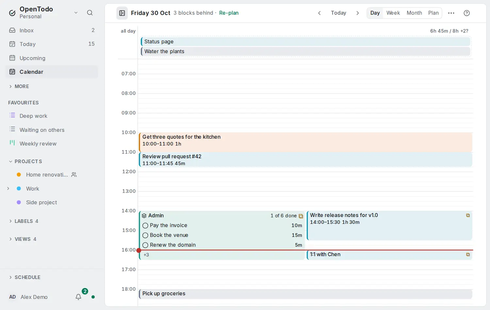

# Slots

<picture><source srcset="images/slots-dark.webp" media="(prefers-color-scheme: dark)"></picture>

Ten five-minute tasks on the [calendar](calendar-views.md) make ten slivers. A **slot** is one block, such as *Admin · 16:00–16:45*, holding a checklist of small tasks you do in one go.

## Make a slot

- In **Day** or **Week**, choose **⋯** › **New slot**: the next free quarter hour of the selected day (or today), for 30 minutes.
- **New slot** in the [command palette](search.md#commands) does the same for today.
- In a [frame](frames.md)'s details, **Make a slot here** fills that frame with a slot of the same title and colour.

The title opens for editing; without one it reads *Slot*.

## Put tasks in it

- **Drag** a task onto the slot from a list, the [planning list](time-blocking.md#place-a-task-on-the-calendar), the **Unscheduled** lane or a block.
- **Keyboard**: press **s** on a task, move over the slot with the arrows and press **Shift+Enter**. **Enter** still places the task as its own block.
- **Phone**: the task's **Schedule** sheet offers the day's slots, such as *Add to Admin 16:00*.

Adding a task sets its date to the slot's day without a time, so it shows in Today and Upcoming, and takes it out of that day's other slots. One **Undo** reverts it all. A slot holds up to 20 tasks, and a task you may only view is added only when it is already on that day.

## Work through it

The block shows a stack icon, the title, a count such as *2 of 5 done* and as many rows as fit; **+n** opens the rest. Completed tasks stay checked at the end.

- Tick a row's circle to complete it.
- **Tab** to a row, then **↑** and **↓** move, **Space** completes and **Enter** opens the task.
- Choose the title or the count to rename the slot, see every task, take one out, change the colour or delete it.

## Move, resize, delete

- **Drag** the slot to another time or day; its tasks follow it to the new day.
- **Drag its lower edge** to change the length, 15 minutes to 8 hours.
- Select it by clicking its edge: **↑** and **↓** move it 15 minutes, **←** and **→** a day, **Shift+↑** and **Shift+↓** change the length.
- **Drag a row out** onto the grid to give that task its own time.
- **Delete slot** leaves its tasks on that day in the **Unscheduled** lane, with **Undo**.

## Capacity and lists

A slot counts once toward the [day's capacity](place-tasks-on-the-calendar.md): its length, or its tasks' estimates when they add up to more, shown as *50m in 45m* in the warning colour. Month and Plan list its tasks as usual and count the slot the same way.

In Today and other lists, a task in a slot shows the slot's start with the stack icon; its tooltip names the slot. [Re-plan the rest of the day](replan-the-day.md) treats slots as busy time and never moves them. On a phone, the Week shows a slot as one row that expands to its tasks.

## Sync and other tools

- Slots sync to your own devices only and work offline; people you share a project with only see the task's date.
- With [end-to-end encryption](e2ee.md), the title is encrypted.
- Slots are in your [export](import-export.md). The [REST API](api.md#calendar-slots), the [command line](cli.md#calendar-slots) (`ot slots`) and [MCP assistants](mcp.md) can read them; assistants cannot change them.
- Calendar apps see the tasks as ordinary date-only tasks.

Slots don't repeat yet; a frame with **Make a slot here** covers a daily habit.
