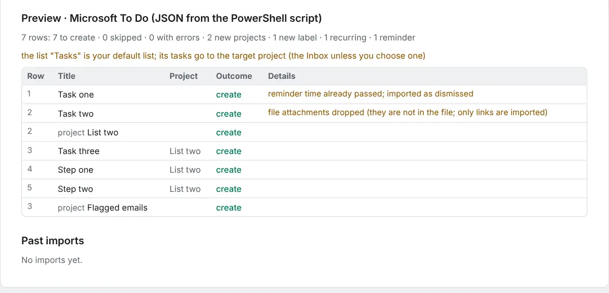

# Switch from Microsoft To Do

Microsoft has announced that the To Do apps retire on 30 June 2027. To Do has no export button, but Microsoft Graph, the service behind it, lets you read your own lists. A short PowerShell script saves them to one file, `todo.json`, and OpenTodo imports it with a preview first and Undo after. It takes about ten minutes.

## Export from Microsoft To Do

The script only reads. It asks Microsoft for one permission, **Tasks.Read** (read your tasks and task lists), and changes nothing in To Do. Your lists stay where they are until you delete them.

### On Windows

1. Open **Terminal** (or Command Prompt) and install PowerShell 7:
   ```
   winget install --id Microsoft.PowerShell --source winget
   ```
   No `winget`? Install **App Installer** from the Microsoft Store, or download the `.msi` from [PowerShell's releases](https://github.com/PowerShell/PowerShell/releases).
2. Open **PowerShell 7** from the Start menu. It is not the older **Windows PowerShell**: the window's first line says `PowerShell 7`.
3. Continue with **Run the script** below.

### On macOS

1. Install PowerShell 7, either with [Homebrew](https://brew.sh) in **Terminal**:
   ```
   brew install --cask powershell
   ```
   or with the `.pkg` from [PowerShell's releases](https://github.com/PowerShell/PowerShell/releases) (`osx-arm64` for Apple silicon, `osx-x64` for Intel).
2. Open **Terminal** and type `pwsh`, then press Return.
3. Continue with **Run the script** below.

### Run the script

1. Install Microsoft's sign-in module (once):
   ```powershell
   Install-Module Microsoft.Graph.Authentication -Scope CurrentUser
   ```
   If it asks whether to trust the repository **PSGallery**, type `A` and press Enter.
2. Paste the whole script and press Enter:
   ```powershell
   Connect-MgGraph -Scopes "Tasks.Read"

   function Get-All($uri) {
     $items = @()
     while ($uri) {
       $page = Invoke-MgGraphRequest -Method GET -Uri $uri
       $items += $page.value
       $uri = $page.'@odata.nextLink'
     }
     return ,$items
   }

   $lists = Get-All "v1.0/me/todo/lists"
   foreach ($list in $lists) {
     Write-Host "Reading $($list.displayName)"
     $list["tasks"] = Get-All "v1.0/me/todo/lists/$($list.id)/tasks?`$expand=checklistItems,linkedResources"
   }
   $out = Join-Path $HOME "todo.json"
   ConvertTo-Json -InputObject @($lists) -Depth 10 | Set-Content -Encoding utf8 $out
   Disconnect-MgGraph
   Write-Host "Saved $($lists.Count) lists to $out"
   ```
3. A Microsoft sign-in opens (a window on Windows, your browser on macOS). Sign in with the account you use in To Do. It asks to let **Microsoft Graph Command Line Tools** read your tasks and task lists and see your basic profile; accept.
4. The script names each list as it reads it and ends with `Saved … lists to …`. The file is in your home folder: `C:\Users\<you>\todo.json` on Windows, `/Users/<you>/todo.json` on macOS.

The permission stays on your Microsoft account until you remove it under [Apps and services](https://account.live.com/consent/Manage). A tasks file from a Microsoft data export imports the same way when it holds the same task lists. <!-- verify -->

## Import into OpenTodo

1. Open **Settings → Data → Import data** (or press `g` then `Shift+I`).
2. Under **Switching from…**, choose **Microsoft To Do**.
3. Choose `todo.json`. The preview shows **Preview · Microsoft To Do (JSON from the PowerShell script)**, how many projects, labels and tasks it will create, and the first rows with their warnings.
4. Check the options if you need to: **Tasks without a project go to** (your Inbox unless you choose a project), **Workspace** when you have more than one, and **Possible duplicates** if you already copied some tasks by hand.
5. Select **Import**.

<picture><source srcset="../images/import-microsoft-todo-dark.webp" media="(prefers-color-scheme: dark)"></picture>

Your other devices receive everything on their next sync. Importing the same file again creates nothing twice. To take it all back, select **Undo** next to the import under **Past imports**, then **Undo import**.

## How things map

| Microsoft To Do | OpenTodo |
| --- | --- |
| Lists | Projects, matched by name to projects you already have. |
| List groups | Not carried over: lists arrive side by side. Nest them as [sub-projects](../projects.md#sub-projects), or keep work and home apart in [workspaces](../workspaces.md). |
| Tasks, the default list | Your Inbox, or the project you choose under **Tasks without a project go to**. |
| My Day | Not carried over. [Today](../today-and-upcoming.md#plan-your-day-with-today) shows what is due today; a task you add there is due today. |
| Important (the star) | Priority p1; normal and low importance become p4. The **Important** list is the filter `p1`, which you can [save as a view](../labels-and-filters.md#save-a-filter-as-a-view). |
| Planned | [Upcoming](../today-and-upcoming.md#plan-your-week-with-upcoming) and the [Calendar](../built-in-views.md) show every dated task. |
| Assigned to me | Not carried over. <!-- verify --> In OpenTodo, **Assigned to me** lists tasks people assign you in [shared projects](../sharing.md#assign-tasks). |
| Flagged email | A project **Flagged emails**; each task keeps a link to its email. <!-- verify --> |
| Steps | Subtasks; checked steps are completed. |
| Notes | The task's notes, as plain text: formatting is removed. |
| Due date | The due date, without a time, as To Do has none. <!-- verify --> |
| Reminder | A reminder at the same moment. A reminder already past is imported dismissed. |
| Repeat | A [repeat rule](../recurrence.md) for daily, weekly on chosen days, monthly on a day and yearly repeats. "Every 2 weeks on Monday and Friday", "the second Thursday" and repeat end dates are dropped with a warning; OpenTodo can say [`every 2nd thursday`](../recurrence.md#grammar) and [`until …`](../recurrence.md#end-conditions), so set them again. <!-- verify --> |
| Categories | Labels. |
| Shared lists | Your own projects, with all their tasks; the members are not in the file. [Share the project](../sharing.md#share-a-project) again, or send an [invite link](../sharing.md#invite-with-a-link). |
| Attachments | Links (such as the email a task came from) become link attachments. Files are not in the file and are dropped with a warning; [attach them](../attachments.md) again. |
| Completed tasks | Completed, with their completion time, in **Completed**. |
| Created date | Kept. Each task shows **Imported from Microsoft To Do**. |
| Themes | Not carried over. Give each project a [colour and icon](../projects.md#organise-with-projects), and the app a [theme](../themes.md). |

The field-by-field mapping is in [Import formats](../import.md#microsoft-to-do-microsoft-todo-json).

## If something goes wrong

- **"Running scripts is disabled on this system."** Run `Set-ExecutionPolicy -Scope Process RemoteSigned` and paste the script again. It applies to this window only.
- **`Install-Module` fails, or `Connect-MgGraph` is not recognised.** Check that you are in PowerShell 7: `$PSVersionTable.PSVersion` should start with 7. "No match was found" means the PowerShell Gallery could not be reached; try another network, or run `Register-PSRepository -Default` and install again.
- **No sign-in appears, or it fails.** Replace the first line of the script with `Connect-MgGraph -Scopes "Tasks.Read" -UseDeviceCode`, open the address it prints and enter the code. With a work or school account, "Need admin approval" means your organisation must allow Microsoft Graph Command Line Tools; ask your IT team.
- **`Saved 0 lists`, or the preview finds no tasks.** You signed in with another account. Run `Disconnect-MgGraph`, then the script again, and choose the account you use in To Do.
- **The preview names another format.** Choose **Microsoft To Do** under **Switching from…** and pick the file again.
- **A large account.** The script can take several minutes; let it finish. A file over the server's upload limit (20 MB unless your server owner changed it) imports fine as a ZIP: compress `todo.json` and choose the ZIP. One import holds up to 50,000 tasks and steps.

Still stuck? Ask on [Discord](https://discord.gg/mmSsuCRduD), in [GitHub Discussions](https://github.com/OpenTodoApp/OpenTodo/discussions), or [open an issue](https://github.com/OpenTodoApp/OpenTodo/issues).
