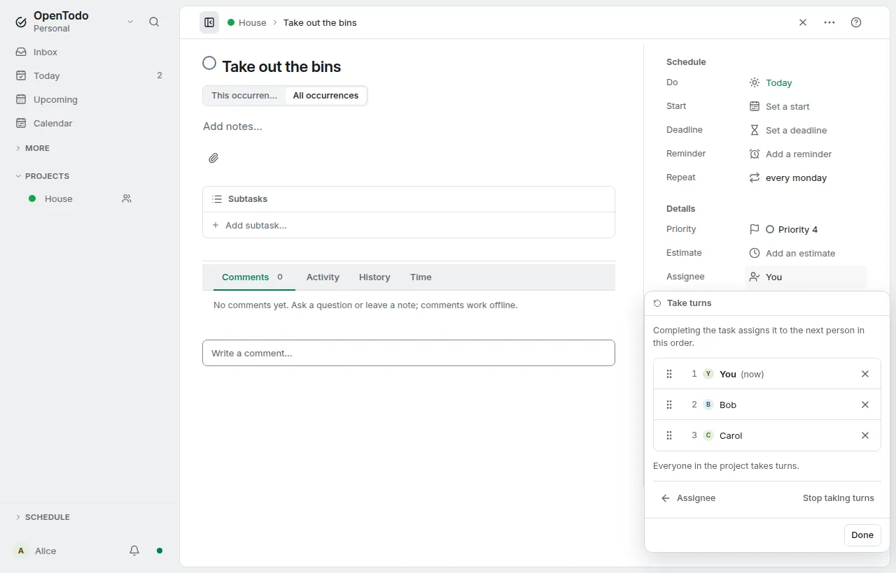

# Take turns

<picture><source srcset="images/take-turns-dark.webp" media="(prefers-color-scheme: dark)"></picture>

A chore that repeats can pass from person to person: the bins on Monday, the bathroom on Saturday. In a shared project with at least two members, open a repeating task, choose its assignee and then **Take turns…**. List the people who take turns:

- Pick people from the project's members, or choose **Add everyone in *group*** to add the current members of a workspace group that shares the project. Later changes to the group don't change the list.
- Drag a person by their handle to change the order, click the handle and choose **Move up** or **Move down**, or focus the handle and press <kbd>Alt</kbd>+<kbd>↑</kbd> or <kbd>Alt</kbd>+<kbd>↓</kbd>.
- **Stop taking turns** clears the list; the current assignee stays.

When someone completes the task, the next occurrence is assigned to the next person in the list, after the current assignee, starting again from the top after the last one. If the current assignee isn't in the list, the first person gets it. The completed occurrence keeps the person who held it, so **Completed** shows who did it. The new assignee gets the usual assignment notification, worded **It's your turn**.

Only completing passes the turn. Skipping an occurrence, changing **this occurrence only**, reopening a completed occurrence and assigning someone by hand don't; after a manual reassignment the next completion continues after the new assignee. When the series ends with a completion, the assignee stays.

The task panel shows the order under the assignee, for example **Takes turns: Alice → Bob → Carol**, with the current assignee in bold, and the task's row marks the assignee's avatar with a small rotate sign. Viewers see the order but can't change it. Your Inbox, a project only you belong to, a task that doesn't repeat and a subtask don't offer **Take turns…**; a list kept on such a task does nothing until it qualifies again (for example when you add a rule back).

When someone leaves the project, is removed or deletes their account, the server takes them out of every list in that project. If it was their turn, the task goes to the next person in the list who is still a member, who gets the same **It's your turn** notification as after a completion (unless they removed the person themselves), or is unassigned when nobody is left. New members are never added to a list automatically.

Every device that completes the task offline picks the same next person, so two people completing the same occurrence at the same time end up with one completion and one assignee.
