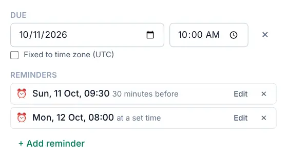

# Task reminders

<picture><source srcset="images/reminders-dark.webp" media="(prefers-color-scheme: dark)"></picture>

A reminder gives you a nudge at a moment you choose. Reminders are personal, even in shared projects (see [Recurring tasks and reminders](recurring-and-reminders.md#shared-projects)), and the [reminders reference](reminders.md) has the details on snooze, web push and privacy.

## Add a reminder

Open a task and select **+ Add reminder** under **Reminders**. Choose one of:

- **At due time**, **10 minutes before**, **30 minutes before**, **1 hour before** or **1 day before**,
- **Custom offset…**, for any number of minutes, hours or days before or after,
- once the task has a [deadline](tasks-and-projects.md#deadlines): **On the deadline**, **1 day before the deadline** or **Custom before the deadline…**. These count from 09:00 on the deadline day and follow the deadline, not the due date,
- **At a specific date and time…**, for a fixed moment that doesn't depend on the due date. Its date and time fields work like the ones under **Due**: type the date and time in your format or pick them from the calendar and the list of times (see [Dates and times](tasks-and-projects.md#dates-and-times)).

Reminders are listed with their day, date and time in your format, for example `Tue 3 Nov, 09:00`. A task can have several reminders. Reminders relative to the due time move with it: change the due date and they follow, and on a repeating task they carry over to the next occurrence. If the task has a date but no time, "before" and "after" count from 09:00 that day.

To add the same reminder to every task that gets a date, set a [default reminder](default-reminders.md).

## When a reminder goes off

While OpenTodo is open, a reminder pops up in the corner of the screen with **Snooze 10 min**, **1 hour**, **Tomorrow 09:00** and **Dismiss**. This works without a connection and without any permission.

To get reminders when the app is closed, turn on notifications for each device in **Settings → Notifications**. On an iPhone this needs the installed app. See [Notifications](notifications.md).

Snoozing or dismissing on one device applies to all of them.

## Tips

- For bills, use a day-of-month rule (`every 1st`) plus a **1 day before** reminder.
- A reminder on a task without a time fires at 09:00 for "at due time". Give the task a time if you need it earlier.
- Deleted tasks don't remind you. If you restore one, its reminders come back.
- Alarms you add in a calendar app connected over [CalDAV](caldav.md#alarms-and-reminders) become reminders here, and your reminders appear there as alarms.
