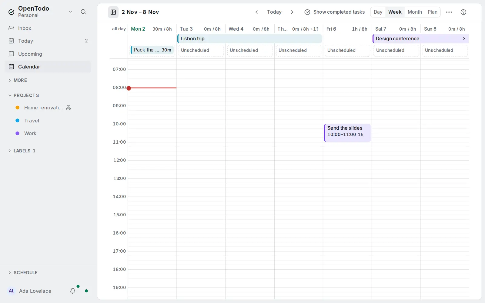

# Tasks that span days

<picture><source srcset="images/spans-calendar-dark.webp" media="(prefers-color-scheme: dark)"></picture>

Some tasks take several days: a trip, a conference, a report you write over a week. A **multi-day** task is drawn across every day from its [start date](deadlines-and-start-dates.md#when-a-task-starts) to its do-on date, instead of as a dot on its last day.

## Make a task multi-day

Open the task's **When** editor, choose **Start** and turn on **Multi-day**. The switch is there when the task has a do-on date. If the task has no start date before that day, the start becomes the day before, so a two-day bar shows at once, and the start date field is ready for you to pick the first day. The When line then reads the range, **3–5 Nov**.

Turning **Multi-day** off keeps the start date: the task is simply deferred until then again. Tasks with a start date are never drawn as a range unless you turn this on.

In Week and Month you can also drag the right end of a task without a time onto a later day, or select it and press <kbd>Shift+→</kbd>: it becomes multi-day from the day it was on.

## See it in the calendar

- **Week** draws one bar across the days in the all-day strip, in the project's colour, above the events of [other calendars](other-calendars.md). A bar that goes on past the week has a square end and an arrow on that side.
- **Day** shows the day's piece with its place, **Day 2 of 3**. A due time shows on the last day as **until 17:00**; a multi-day task is never a block on the grid.
- **Month** draws a bar across each week row and continues it on the next row. Bars count toward a day's **+N more**.
- **Plan** lists the task in each day's column with **Day 2 of 3**.
- On a phone the Week lists it under each day it covers, and the Month counts it on each of them.

Its [estimate](time-blocking.md) counts on the last day only. A repeating multi-day task keeps its length on every occurrence, and its coming occurrences are drawn as dimmed bars.

## Move and stretch it

- Drag the middle of the bar to move the whole range. Drag its left or right end to change the first or last day.
- Select it, then <kbd>←</kbd> <kbd>→</kbd> move it a day, <kbd>Shift+←</kbd> <kbd>Shift+→</kbd> move the last day and <kbd>Alt+Shift+←</kbd> <kbd>Alt+Shift+→</kbd> the first day.

Each change is one step you can undo. A range shrunk to one day stays multi-day and simply shows on that day. In a project where you're a viewer the bar can't be moved. On a phone, change the dates in the **When** sheet.

## In your lists

Before its first day, Upcoming lists the task once, under that day, with its range. From the first day it's in Today with **until 5 Nov**, and on the last day it's due like any task.

Other apps see the range where they can: calendar feeds and [calendar sync](calendar-sync.md) write it as an all-day event over the days, and CalDAV apps show it on its last day.
