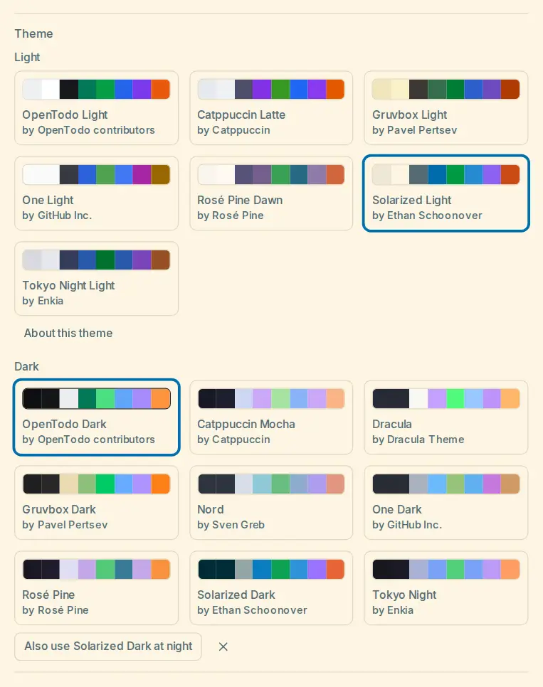

# Themes

A theme sets the colours of the whole interface, the way a theme does in a code editor, and optionally its corner radii and typeface. You choose one theme for when the app is light and one for when it is dark, in **Settings → Appearance → Theme and density**, under **Theme**. With the mode **System** both lists show, **Light** and **Dark**, and the app switches between your two themes when your device switches between light and dark. The choice follows your account to every device, also offline, and applies at once.

Besides the two OpenTodo themes, **OpenTodo Light** and **OpenTodo Dark** (the defaults), the app ships fourteen themes from well-known editor palettes: the [catalogue](#catalogue). A theme chosen on a newer version shows as **Made with a newer version of OpenTodo** on an older one, which then shows the OpenTodo theme for that side and keeps your choice for when it is updated.

## Catalogue

<picture><source srcset="images/theme-catalogue-dark.webp" media="(prefers-color-scheme: dark)"></picture>

Each list shows the OpenTodo theme first, then the palettes of its kind by name; a palette that is only published dark (Nord, Dracula) is only in the **Dark** list. Each card credits the palette's author. Choosing a theme applies it at once, also offline: the themes are part of the app, and the catalogue loads with Settings, never with the first screen.

| Light | Dark | Palette by |
| --- | --- | --- |
| Catppuccin Latte | Catppuccin Mocha | Catppuccin |
| Gruvbox Light | Gruvbox Dark | Pavel Pertsev |
| One Light | One Dark | GitHub Inc. (Atom's One themes) |
| Rosé Pine Dawn | Rosé Pine | Rosé Pine |
| Solarized Light | Solarized Dark | Ethan Schoonover |
| Tokyo Night Light | Tokyo Night | Enkia |
| | Nord | Sven Greb |
| | Dracula | Dracula Theme |

With the mode **System**, choosing a theme of a light and dark pair while the other side has a theme of another family offers its counterpart: **Also use Solarized Dark at night** (or **Also use … by day**) sets the other side too, and the cross dismisses the offer without changing anything.

A palette is mapped onto OpenTodo's colours by one written mapping ([`MAPPING.md`](https://github.com/OpenTodoApp/OpenTodo/blob/main/web/src/lib/theme/builtin/MAPPING.md)): its background, panel, text and comment colours go to the surfaces and text tones, its accent to the accent, its green, yellow, red and blue to the status colours, and its accent colours to the label colours by nearest hue (a label colour the palette has none for uses OpenTodo's hue at the palette's lightness). The palettes set colours only: the typeface, corners and text size stay OpenTodo's, so switching never moves the layout. Every theme passes the [contrast](#contrast) check: where a published colour is too faint for its place (for example a palette's comment colour used for secondary text), the theme uses the same hue at the nearest lightness that passes and keeps the published value in its file (`notes.adapted`); its details then say **Some colours were adapted for contrast**.

**About this theme**, under a list whose chosen theme is a palette, shows its author, licence, copyright line and project address (as text, nothing is loaded from it) and **Licence**, which opens the full notices served by your own server.

### Credits

Every palette is under the MIT licence; the full notices ship with the app ([`CREDITS.md`](https://github.com/OpenTodoApp/OpenTodo/blob/main/web/src/lib/theme/builtin/CREDITS.md)). The names are used only to credit the palettes: **OpenTodo is not affiliated with these projects.**

| Palette | Project | Copyright |
| --- | --- | --- |
| Solarized | github.com/altercation/solarized | Copyright (c) 2011 Ethan Schoonover |
| Gruvbox | github.com/morhetz/gruvbox (licence file of github.com/gruvbox-community/gruvbox) | Copyright (c) 2018 Pavel Pertsev |
| Catppuccin | github.com/catppuccin/catppuccin | Copyright (c) 2021 Catppuccin |
| Rosé Pine | github.com/rose-pine/rose-pine-theme | Copyright (c) 2023 Rosé Pine |
| Tokyo Night | github.com/enkia/tokyo-night-vscode-theme | Copyright (c) 2018-present Enkia |
| One Light, One Dark | github.com/atom/one-light-syntax, github.com/atom/one-dark-syntax | Copyright (c) 2016 GitHub Inc. |
| Nord | github.com/nordtheme/nord | Copyright (c) 2016-present Sven Greb |
| Dracula | github.com/dracula/dracula-theme | Copyright (c) 2023 Dracula Theme |

Not shipped: GitHub's Primer palette (the names are GitHub's marks), Monokai (no clear open licence; Monokai Pro is a commercial product of the same name) and Material Theme (relicensed, the terms of the name unclear). A palette joins the catalogue only with a licence file, no naming terms that forbid the use, and an entry in the credits.

## Themes and the accent

The accent (**Emerald** to **Graphite**, or your [own colour](custom-accent.md)) colours the OpenTodo themes. Another theme brings its own accent: while it is shown, the accent row says **From the theme**, and your accent comes back when you choose an OpenTodo theme again. High contrast (on the [display](display-mode.md)) always wins over a theme's colours; the theme's corners and type stay.

## What a theme is

A theme is a small JSON file (`.opentodo-theme.json`). It names a few **seeds**, and every colour it does not set is derived from them on your device, so a theme of four colours is complete, and stays complete when OpenTodo adds a colour later. The format is published as a JSON Schema, [`docs/themes/opentodo-theme.schema.json`](themes/opentodo-theme.schema.json); the two OpenTodo themes are the reference documents (`web/src/lib/theme/builtin/opentodo-light.json` and `opentodo-dark.json`, generated from the stylesheet), and the catalogue's documents sit next to them (`nord.json`, `solarized-light.json` and the others).

```json
{
  "opentodoTheme": 1,
  "id": "nord",
  "name": "Nord",
  "author": "Sven Greb",
  "licence": "MIT",
  "source": "https://github.com/nordtheme/nord",
  "kind": "dark",
  "seeds": { "canvas": "#2e3440", "surface": "#3b4252", "text": "#eceff4", "accent": "#88c0d0" },
  "tokens": { "muted": "#d8dee9" },
  "bar": "#2e3440",
  "shape": { "radius": { "card": 6 } },
  "type": { "family": "system", "list": 14 }
}
```

### Keys

| Key | Required | Value |
| --- | --- | --- |
| `opentodoTheme` | yes | The format version, `1`. Adding a token never changes it; a newer format is not applied by an older app. |
| `id` | yes | 1 to 64 characters of `a-z`, `0-9` and `-`. |
| `name` | yes | 1 to 60 characters, shown on the theme's card. |
| `author`, `licence` | yes | Up to 120 characters each; the author is credited on the card. Use an SPDX identifier for the licence where one applies. |
| `source` | no | Where the palette comes from, up to 300 characters. Shown as text, never fetched. |
| `kind` | yes | `light` or `dark`. A theme is one side; a light and dark pair is two files. |
| `seeds` | yes | `canvas`, `surface`, `text` and `accent`, and optionally `success`, `warning`, `danger` and `info`. |
| `tokens` | no | Explicit values for any token of the list below. A name this app does not know is kept and ignored. |
| `bar` | no | The browser and phone bar colour. By default the accent of a light theme and the canvas of a dark one. |
| `notes` | no | `adapted`, the published colour each adjusted token replaced, and `text`, up to 500 characters. |
| `shape.radius` | no | Corner radii in whole pixels, 0 to 20: `chip`, `control`, `card`, `surface`, `popover`. A step left out keeps OpenTodo's proportion to the nearest given step. |
| `type.family` | no | `inter` (the bundled typeface, the default), `system`, `serif`, `mono`, or `{ "local": "Font name" }` for a font installed on the device (letters, digits, spaces and hyphens). Never a font from another host. |
| `type.list` | no | The list text size in pixels: `13` (the default), `14` or `15`. It scales with the browser's font size. |

A colour is `#rrggbb` or `oklch(L C H)` with L from 0 to 1, C from 0 to 0.4 and H from 0 to 360, inside the sRGB gamut. Only `scrim` may be translucent (`#rrggbbaa` or `oklch(L C H / a)`). Nothing else is accepted, so a theme can never carry CSS, a `url()` or a reference to another value. A file is at most 16 KB. The app and the server accept and refuse exactly the same files.

### Tokens

| Group | Tokens |
| --- | --- |
| Surfaces | `canvas`, `surface`, `raised`, `sunken`, `pop`, `hover`, `selected`, `selected-row`, `sidebar` |
| Text | `text-strong`, `text`, `muted`, `faint` |
| Lines | `border`, `border-soft`, `border-input`, `line-strong` |
| Accent | `accent`, `accent-hover`, `on-accent`, `accent-text`, `accent-soft`, `accent-soft-text`, `focus` |
| Status | `success`, `success-soft`, `success-soft-text`, `warning`, `warning-soft`, `warning-soft-text`, `danger`, `danger-soft`, `danger-soft-text`, `info`, `info-soft`, `info-soft-text` |
| Priorities | `p1`, `p1-soft`, `p2`, `p2-soft`, `p3`, `p3-soft`, `p4`, `p4-soft` |
| Labels | `hue-red`, `hue-orange`, `hue-yellow`, `hue-lime`, `hue-green`, `hue-teal`, `hue-cyan`, `hue-blue`, `hue-indigo`, `hue-violet`, `hue-pink`, `hue-slate` (the solid step; the soft and text steps of each label colour are always derived) |
| Other | `scrim`, `highlight`, `highlight-text`, `chart-base`, `chart-seq-1`, `chart-seq-2`, `chart-seq-3`, `chart-seq-4`, `chart-seq-5` |

Projects, labels and views keep their stored colour and draw it through the theme's label colours: a green project uses the theme's `hue-green`.

## How missing colours are derived

Every token a theme does not set starts from OpenTodo's own value for the theme's kind, carried onto the theme's seeds: it keeps its lightness distance from the seed it belongs to (`raised` from `surface`, `muted` from `text`, a status colour's soft step from `surface`), a near-grey seed keeps OpenTodo's cool slate tint, and a coloured seed gives its own hue. The accent's hover, soft and focus steps, the label colours' soft and text steps and the chart ramp mix as the stylesheet mixes them. Then each colour moves only its lightness, keeping its hue, to the nearest value at which every contrast pair it takes part in passes. A colour that already passes does not move, so OpenTodo's own seeds give exactly OpenTodo's colours. Text on the accent is white or the theme's darkest colour, whichever needs the smaller change, and an accent close to the red of errors turns away from it as a [custom accent](custom-accent.md#away-from-the-red-of-errors) does.

A value written in `tokens` is never moved, even when it fails a pair: the theme's author decides. The derivation is deterministic, so every device shows the same colours for the same file and app version.

## Contrast

Every theme in the repository passes the same contrast rules as the stylesheet ([design system](design-system.md#tokens)): 4.5:1 for text on every surface it may appear on, 3:1 for borders, focus rings and marks, in its own kind. The check in `make check` derives each theme as a device does and names the theme, the pair and both ratios when one fails, and it derives 200 themes from a fixed sweep of seeds (light and dark canvases around the hue circle, pale and saturated accents) that must all pass: the derivation's guarantee.

## Privacy and storage

Your theme choices are preferences, not content: they are not end-to-end encrypted, also when your account is. They are part of the JSON export and come back with an import. A theme never contacts another server: there are no web fonts, images or links in a theme, and its source is only text. Each device remembers the resolved colours of your two themes so the first frame is already in your theme; that memory never syncs.

## No custom CSS

Free-form custom CSS is not offered, for three reasons. CSS can load from anywhere (backgrounds, fonts, cursors), so a synced snippet would make every device contact a server nobody configured. CSS targets the app's structure, which changes in every release, so a snippet that worked yesterday can make the app unusable on every synced device at once. And CSS can hide controls or make text the colour of its background, defeating the contrast and accessibility checks. Themes cover colours, corners, the typeface and the text size, with contrast checks and a way back. The question is open again when several people ask for something tokens cannot express, in a form that stays on one device and cannot load anything.
