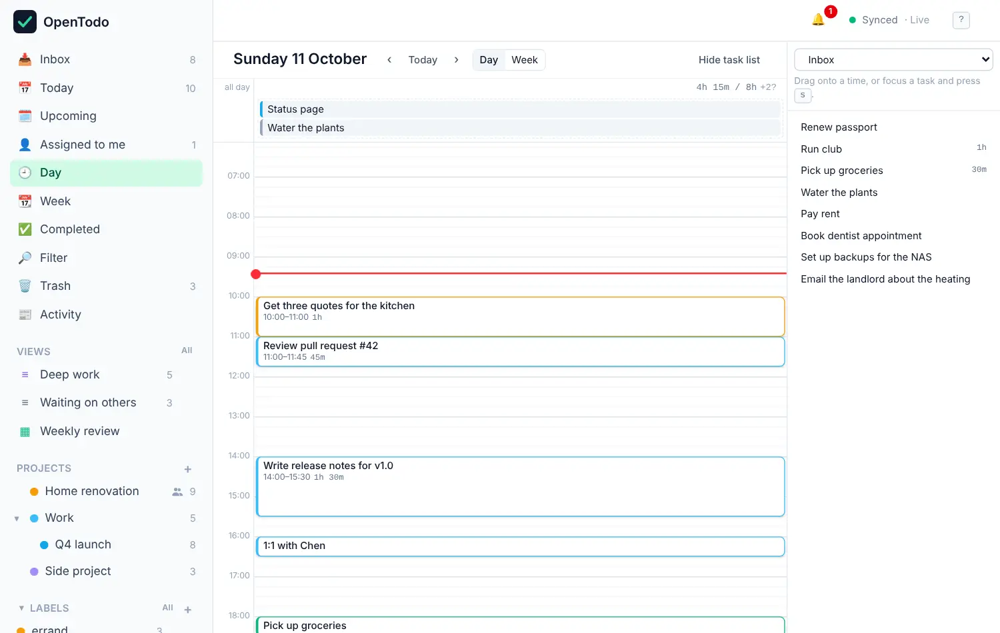

# Time blocking

A to-do list tells you what to do. A calendar tells you when. Time blocking puts the two together: give tasks an estimate, drop them on the Day or Week calendar, and you can see at a glance whether your day is realistic.

## Estimate how long a task takes

Select a task and press <kbd>e</kbd>, then type `20`, `45m`, `1h` or `1h30` and press <kbd>Enter</kbd>. In the task panel, **Estimate** also has buttons for 15 minutes up to 2 hours. In quick add, write `+30m` or `+1h30`.

The estimate shows on the task row, like `45m` or `1h 30m`.

## Open the calendar

Choose **Day** or **Week** in the sidebar, or press <kbd>g</kbd> <kbd>d</kbd> or <kbd>g</kbd> <kbd>w</kbd>.

<picture><source srcset="images/week-dark.webp" media="(prefers-color-scheme: dark)"></picture>

- Tasks with a date **and** a time appear as blocks at that time. The block is as tall as the estimate.
- A timed task without an estimate gets a 30-minute block with a dashed outline.
- Tasks with a date but no time wait in the **Unscheduled** lane at the top of their day.
- A red line marks the current time.

Use **‹** and **›** (or <kbd>[</kbd> and <kbd>]</kbd>) to go back and forward, and **Today** (or <kbd>t</kbd>) to come back.

## Place a task on the calendar

Drag a task from the Unscheduled lane onto a time slot. Its due date and time become that slot. The grid works in 15-minute steps.

To plan from your lists, open the side list with **Plan from a list** and drag tasks from there onto the calendar.

To change how long something takes, drag the bottom edge of its block. Dropping a block back on the Unscheduled lane keeps the date and removes the time.

### With the keyboard

Every move works without a mouse.

1. In Today, a project or any list, select a task and press <kbd>s</kbd>. The Day view opens with the task ready to place.
2. Move it with the arrow keys: <kbd>↑</kbd> / <kbd>↓</kbd> by 15 minutes, <kbd>←</kbd> / <kbd>→</kbd> by a day.
3. Press <kbd>Enter</kbd> to place it, or <kbd>Esc</kbd> to cancel.

On the calendar itself, <kbd>j</kbd> / <kbd>k</kbd> select tasks, the arrows move the selected one, <kbd>Shift</kbd>+<kbd>↑</kbd> / <kbd>Shift</kbd>+<kbd>↓</kbd> shorten or lengthen it, and <kbd>u</kbd> takes it off the grid while keeping its date.

## See whether the day fits

Each day's header adds up the estimates of its open tasks and compares them with your day length, for example `4h 15m / 8h`. When you've planned more than the day holds, the header is marked as over capacity. That's your cue to move something.

Tasks that overlap in time are shown side by side, with a marker, so nothing hides behind something else.

Completing a task removes its block and lowers the day's total.

<picture><source srcset="images/day-dark.webp" media="(prefers-color-scheme: dark)"></picture>

## Adjust the grid

In **Settings → Calendar** you can set when the grid starts and ends (6:00 to 22:00 by default; you can still scroll beyond) and how long your working day is (8 hours by default). These settings belong to each device, so your phone and laptop can differ.

## Tips

- Estimate generously at first. After a week you'll know how long "quick" things really take.
- Leave gaps. A day planned to the minute falls apart at the first phone call.
- The **Quick wins** button above your lists shows tasks of 15 minutes or less, good for filling a short gap.
- Dates and times you set on the calendar are ordinary due dates, so they show up in Today and Upcoming as well, and in calendar apps connected over [CalDAV](caldav.md).
