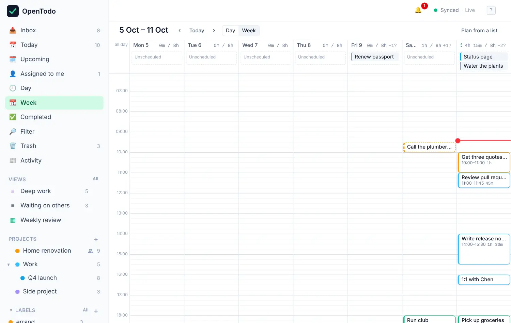

# Time blocking

<picture><source srcset="images/week-dark.webp" media="(prefers-color-scheme: dark)"></picture>

A to-do list tells you what to do. A calendar tells you when. Time blocking puts the two together: give tasks an estimate, drop them on the Day or Week calendar, and you can see at a glance whether your day is realistic.

## Estimate how long a task takes

Select a task and press <kbd>e</kbd>, then type `20`, `45m`, `1h` or `1h30` and press <kbd>Enter</kbd>. In the task panel, **Estimate** also has buttons for 15 minutes up to 2 hours. In quick add, write `+30m` or `+1h30`.

The estimate shows on the task row, like `45m` or `1h 30m`.

## Open the calendar

Choose **Calendar** in the sidebar, then **Day**, **Week**, **Month** or **Plan** in its header, or press <kbd>g</kbd> <kbd>d</kbd>, <kbd>g</kbd> <kbd>w</kbd>, <kbd>g</kbd> <kbd>m</kbd> or <kbd>g</kbd> <kbd>Shift+C</kbd>. Timed tasks are blocks as tall as their estimate; dated tasks without a time wait in the **Unscheduled** lane. The sidebar opens the calendar the way you last left it on this device. See [Day, Week and Month](calendar-views.md#open-the-calendar).

## See the month

**Month** shows six weeks at a glance, each day with its open tasks and planned total. Drag a task onto another day to move it. See [See the month](calendar-views.md#see-the-month).

## Plan a project on a timeline

For work that spans weeks, switch the project to **Timeline**. Each task is a bar from its start to its deadline, so overlaps and gaps show; drag bars to reschedule. See [Sections and boards](sections-and-boards.md#see-a-project-on-a-timeline).

## Plan the next two weeks

**Plan** counts meetings and repeating tasks too. See [Plan the next two weeks](calendar-views.md#plan-the-next-two-weeks).

## Place a task on the calendar

Drag a task from the Unscheduled lane onto a time slot, or select it in any list and press <kbd>s</kbd> to place it with the keyboard. Drag the bottom edge of a block to change how long it takes. See [Place tasks on the calendar](place-tasks-on-the-calendar.md#place-a-task-on-the-calendar).

## See whether the day fits

Each day's header adds up the estimates of its open tasks against your day length, for example `4h 15m / 8h`, and is marked when you've planned more than the day holds. See [See whether the day fits](place-tasks-on-the-calendar.md#see-whether-the-day-fits).

## See your other calendars

When the server owner has turned on [calendar feeds](calendar-feeds.md), events from your Google, Outlook or Apple calendars appear in Day and Week beside your tasks: read-only, marked when they overlap a task, and never counted in the day's total. See [Other calendars in Day and Week](other-calendars.md).

## Adjust the grid

On a phone the Week is a list: each day with its unscheduled tasks and its timed tasks in order, so nothing is squeezed into seven columns. Tap a task to select it, tap again (or press Enter) to open it.

In **Settings → General → Calendar** you can set when the grid starts and ends (6:00 to 22:00 by default; you can still scroll beyond) and how long your working day is (8 hours by default). These settings belong to each device, so your phone and laptop can differ.

## Tips

- Estimate generously at first. After a week you'll know how long "quick" things really take.
- Leave gaps. A day planned to the minute falls apart at the first phone call.
- **Quick wins**, under the **Filter** action in a list's header, shows tasks of 15 minutes or less, good for filling a short gap.
- Dates and times you set on the calendar are ordinary due dates, so they show up in Today and Upcoming as well, and in calendar apps connected over [CalDAV](caldav.md).
