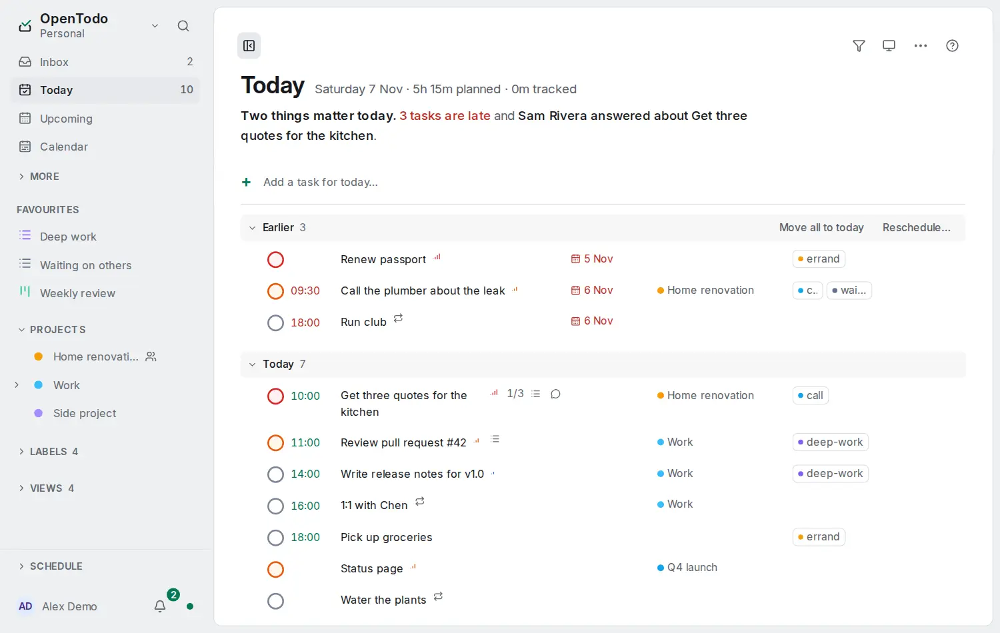

# Time sectors

<picture><source srcset="images/today-dark.webp" media="(prefers-color-scheme: dark)"></picture>

Some work belongs to a week, not a day. A due date for it is a fake date that turns red on Tuesday. A **time sector** plans the task for a period instead; only real appointments and [deadlines](deadlines-and-start-dates.md) keep a date.

## What a sector is

A task's sector is one period:

- a week, stored as its ISO week: `2026-W45` (weeks 1 to 52, and 53 in years that have one);
- a month: `2026-11`;
- a quarter: `2026-Q4`.

A task with a sector and no do-on date is planned. It leaves the Inbox and [Anytime](built-in-views.md#anytime-for-when-you-have-time), is never overdue, and is in Today only when its deadline is.

The stored value never changes by itself. "This week" is worked out on each device from today's date and your first day of the week, so the same task reads **This week** on Wednesday and **From week 45** after the week has ended. A sector whose period has ended is **carried over**: it is shown quietly, never in the overdue colour, and nothing is rewritten. Everyone who shares a project sees the same period, whatever day their week starts on.

## Turn them on

Time sectors are off until you turn on **Time sectors** in **Settings → Account → How you work**, whatever way of working you chose there. It syncs to your devices. Off hides the controls, never a sector: a task that has one keeps its chip and can be cleared.

## Plan a task for a period

- **When editor:** the **Sector** tab, after **Do on** and **Start**, offers **This week**, **Next week**, **This month**, **Next month**, **This quarter** and **Next quarter**, each with its dates, and **Later…** for a week, month or quarter further out. **Clear** removes the sector.
- **Command palette:** **Set time sector…** plans the selected tasks at once, with one **Undo**.
- **Quick add:** `Draft the budget this week` or `Call Bo sometime next week` (see [quick add](quick-add.md)).

A sector is the task's one "when": choosing it clears the do-on date and the start, and giving the task a date or parking it in Someday clears the sector, in one change you can undo. The deadline stays. A repeating task keeps its date, so the Sector tab says so instead.

A row shows the sector where the date would be: **This week**, **Next month**, **Week 47**. If a script writes both a date and a sector, the date wins. Filter with `sector: this week`, `carried` or `no sector` ([filters](filters.md)).

## Plan the week from your sectors

In the Calendar, **Plan from a list** offers **Time sectors**: the tasks grouped under **Carried over**, **This week**, **Next week** and later, each group with its count and estimates. Only tasks you can work on now are listed; a blocked task or one waiting behind an earlier step is counted as **waiting**. Drag a task onto a day, press <kbd>s</kbd>, or choose **Do today**: it gets that date and leaves its sector, and **Undo** puts it back. The [weekly review](review-and-statistics.md)'s Look ahead lists what was carried over and next week's tasks.

## From other apps and scripts

The [API](api.md#task-fields), [`ot --sector`](cli.md), the [assistant tools](mcp.md), [CalDAV](caldav.md) (`X-OPENTODO-SECTOR`) and the [Markdown vault](vault.md) (`[sector:: 2026-11]`) carry the stored period; relative words are only for people. With [end-to-end encryption](e2ee.md) the sector stays readable to the server, like a date.
