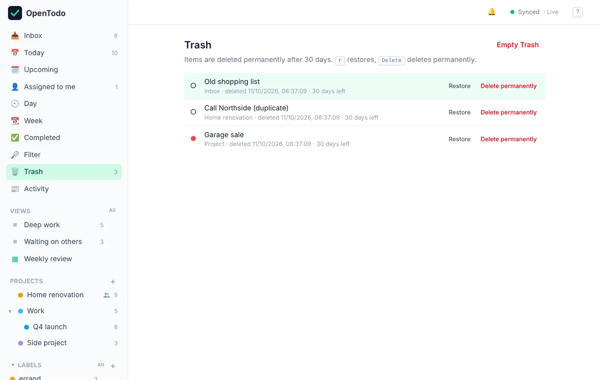
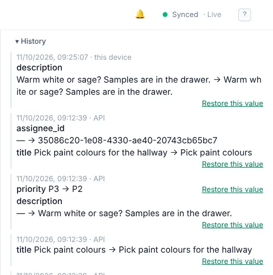

# Trash and history

Deleting something in OpenTodo doesn't make it vanish. It goes to the Trash first, and every change to a task is kept in its history, so a slip of the finger is easy to undo.

## Restore something from the Trash

Open **Trash** in the sidebar (or press <kbd>g</kbd> <kbd>x</kbd>). It lists deleted tasks and projects, newest first, with when they were deleted and how many days they have left.

<picture><source srcset="images/trash-dark.webp" media="(prefers-color-scheme: dark)"></picture>

Select **Restore** next to an item. It comes back exactly where it was:

- A restored project returns to its place in the sidebar, with all its tasks.
- A restored task returns to its project. If that project is still in the Trash, the task goes to your Inbox instead.

With the keyboard: <kbd>j</kbd> / <kbd>k</kbd> to select, <kbd>r</kbd> to restore.

## Delete for good

**Delete permanently** removes one item for good, and **Empty Trash** removes everything in it. Both ask you to confirm, and both need a connection. Once something is permanently deleted, it's gone from every device and from the server, and it can't come back.

Items are also deleted for good automatically after 30 days in the Trash. Your server's owner can change that period or turn it off.

## What deleting does

- Deleting a task also deletes its subtasks.
- Deleting a project hides it and its tasks everywhere. Its sub-projects move up a level, so they aren't lost.
- Reminders on deleted tasks stay quiet. Restore the task and they work again.
- Deleted items are still in your [export](import-export.md#download-everything) until they are deleted for good.

## See what changed on a task

Open a task and select **History** at the bottom of its panel. You see every change, newest first: what the field was, what it became, when, and from where (this device, another device, the API).

<picture><source srcset="images/history-dark.webp" media="(prefers-color-scheme: dark)"></picture>

Projects have a **History** too, at the top of the project.

History is loaded from your server, so it needs a connection.

## Bring back an earlier value

Next to each change in the history is **Restore this value**. Select it to set the field back to what it was then. Restoring is a change like any other: it syncs to all devices and shows up in the history itself, so you can always undo the undo.

## Activity on a task

The comment thread of a task also shows its activity: who created it, completed it, moved it or changed the date. In shared projects this includes everyone's changes. See [Sharing and comments](sharing.md#see-what-others-changed).

## Archived projects

Archiving is different from deleting. An archived project disappears from the sidebar, but it isn't in the Trash and isn't deleted after 30 days: it and its tasks are kept as they are. Archive a project from its **Project** menu.

When you complete the last task of a project, OpenTodo offers to archive it. Projects without open tasks for 30 days are archived automatically, with a notice that has an undo button. To switch automatic archiving off on a device, untick the option under **Settings → Projects**.

The app has no button yet to bring back a project you archived yourself. Scripts can do it through the [API](api.md) by setting the project's `archived` field to `false`.
