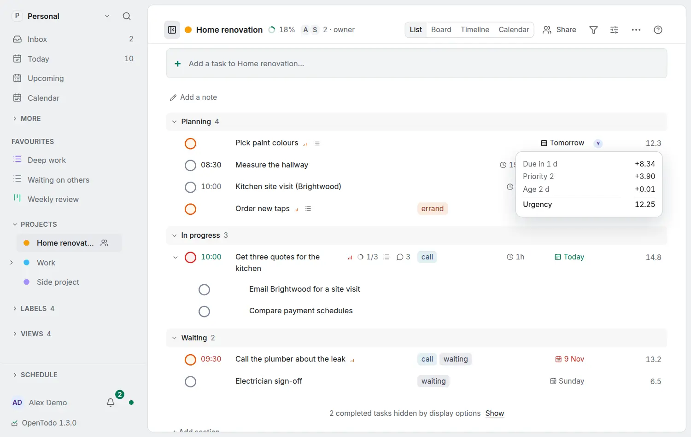

# Order by urgency

<picture><source srcset="images/urgency-order-dark.webp" media="(prefers-color-scheme: dark)"></picture>

**Urgency** in **Display options → Order by** on a project, a label page, the Inbox or a [saved view](saved-views.md) puts what needs you first at the top. Each open task gets a score from what it already has: its date, deadline, priority, the tasks waiting for it, its age and a running timer raise it; being blocked, starting later or parked in Someday lowers it. Nothing is stored and nothing changes until you choose it.

While a list is ordered by urgency, each task shows its score at the end of its row. Tab to the score to read why, or press <kbd>Enter</kbd> on it for the breakdown; **Why here?** in the task's menu shows the same, also on a phone, where rows have no score:

> Due today +8.80 · Priority 1 +6.00 · Blocks 2 tasks +8.00 · Age 30 d +0.16 = 22.96

| Part | Adds |
|---|---|
| Date | up to 12: 12 a week or more late, 8.80 today, 5.60 in a week, 2.40 two weeks or more ahead |
| Deadline | up to 8, the same way |
| Priority | 6 for priority 1, 3.90 for 2, 1.80 for 3 |
| Blocks other tasks | 8 while an open task waits for it |
| Age | up to 2, after a year |
| Running timer | 4 |
| Blocked | −5 while it waits for an open task |
| Starts later | −3 until its start date |
| Someday | −6 |

Equal scores keep the date, priority and manual order. **More options** turns it into *Least urgent first*. The score is the same on every device, works offline and on an encrypted account (it never reads titles or notes), and assistants and the [command line](cli.md) order the same way. The weights are fixed; to rank by your own score (WSJF, RICE, story points), keep it in a Number field and order by that field.
