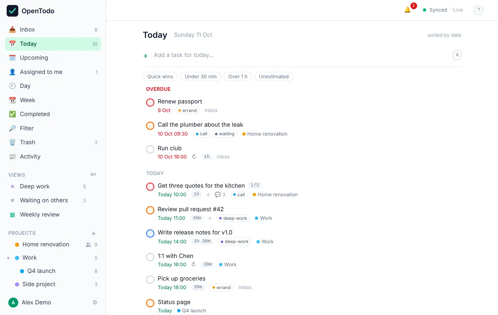
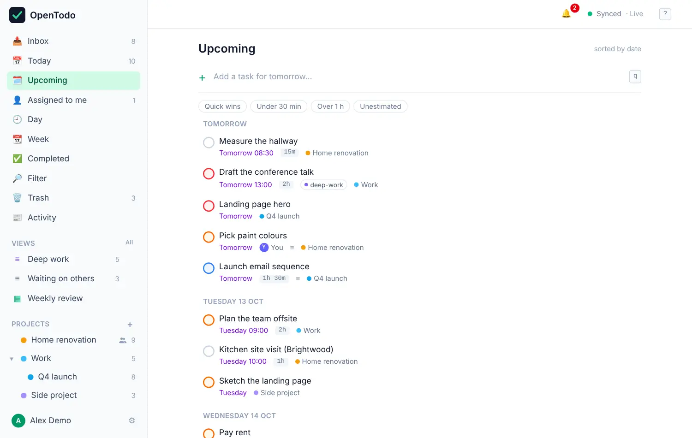
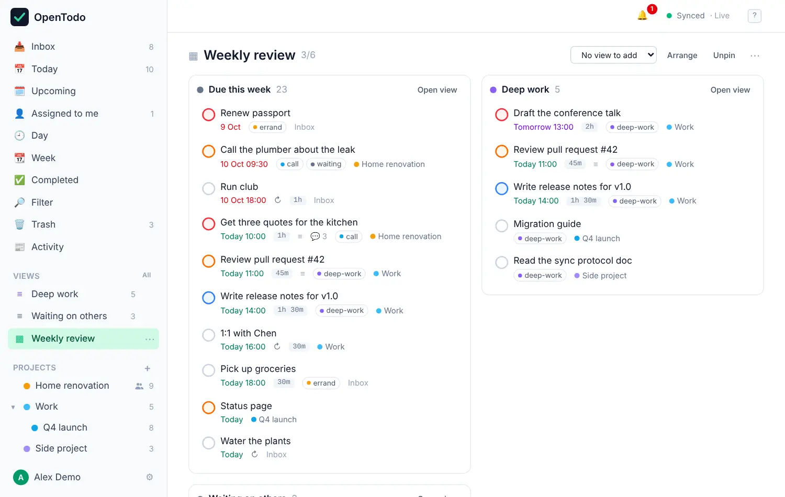

# Views

A view is a way of looking at your tasks. OpenTodo comes with a handful, and you can save your own. Every view is built from the copy of your tasks on your device, so they all work offline and update the moment something changes.

## The built-in views

They're at the top of the sidebar. Each has a shortcut: press <kbd>g</kbd>, then the letter.

| View | Shows | Shortcut |
| --- | --- | --- |
| **Inbox** | Tasks that aren't in a project yet | <kbd>g</kbd> <kbd>i</kbd> |
| **Today** | Tasks due today, with overdue ones first | <kbd>g</kbd> <kbd>t</kbd> |
| **Upcoming** | Tasks due after today, grouped by day | <kbd>g</kbd> <kbd>u</kbd> |
| **Assigned to me** | Open tasks assigned to you, across projects | <kbd>g</kbd> <kbd>a</kbd> |
| **Day** and **Week** | Your timed tasks on a calendar | <kbd>g</kbd> <kbd>d</kbd>, <kbd>g</kbd> <kbd>w</kbd> |
| **Completed** | What you finished most recently | <kbd>g</kbd> <kbd>c</kbd> |
| **Filter** | Any search you can describe | <kbd>g</kbd> <kbd>f</kbd> |
| **Trash** | Deleted tasks and projects | <kbd>g</kbd> <kbd>x</kbd> |
| **Activity** | What changed in your shared projects | <kbd>g</kbd> <kbd>h</kbd> |

The numbers next to the names count open tasks.

## Plan your day with Today

Today is where most people start. Overdue tasks sit in their own group at the top, in red, so nothing slips. Below them are today's tasks, sorted by time.

<picture><source srcset="images/today-dark.webp" media="(prefers-color-scheme: dark)"></picture>

Anything you add here with quick add is due today, unless you type another date. To push a task to later, open it and change **Due**, or press <kbd>s</kbd> to place it on the Day calendar.

## Plan your week with Upcoming

Upcoming lists everything that has a date after today, under headings like **Tomorrow** and the weekday names. It's a good place for a short weekly review: scan the next few days, move what won't fit, and spot empty days.

<picture><source srcset="images/upcoming-dark.webp" media="(prefers-color-scheme: dark)"></picture>

When you want to see the hours, switch to **Week**, which shows your timed tasks as blocks on a grid. See [Time blocking](time-blocking.md).

## Narrow a list by duration

Above most lists are four buttons: **Quick wins** (15 minutes or less), **Under 30 min**, **Over 1 h** and **Unestimated**. Turn one on to see only matching tasks; select it again to clear it. Your choice is remembered on that device. Estimates are set with <kbd>e</kbd> or in the task panel.

## Save your own views

When the built-in views aren't enough, describe what you want in the **Filter** view, then save it. For example, `@waiting & open` lists everything you're waiting on, and `due <= 7 days & p1` shows urgent tasks for the coming week. The filter language is explained in [Labels and filters](labels-and-filters.md).

To save the current filter, press <kbd>s</kbd> in the results (or use the save button), and give it a name. Saved views are pinned to the **Views** group in the sidebar with a live count, and they sync to all your devices.

Each saved view can group its tasks (by project, date, priority or label) and sort them (by date, priority, your own order, creation time or title). Change these from the top of the view. To change the query itself, press <kbd>/</kbd>, edit it and press <kbd>Enter</kbd>.

The **All** link next to **Views** (or <kbd>g</kbd> <kbd>v</kbd>) opens the list of all your saved views. From there you can rename, reorder, unpin or delete them.

## Build a dashboard

A dashboard puts up to six saved views side by side, each showing its count and first ten tasks. It's handy for a morning review: "Due this week", "Deep work" and "Waiting on others" on one screen.

<picture><source srcset="images/dashboard-dark.webp" media="(prefers-color-scheme: dark)"></picture>

Open the views list (<kbd>g</kbd> <kbd>v</kbd>), choose **+ New dashboard**, name it, then add saved views as panels from the dashboard's header. On a phone the panels stack. Move between panels with <kbd>Tab</kbd>, and through a panel's tasks with <kbd>j</kbd> / <kbd>k</kbd>.

## Choose where the app opens

Each device can open on a different view: your laptop on a "Work" view, your phone on Today. Pick it in **Settings → Start view**, or from a saved view's menu with **Set as start view on this device**. If that view is deleted later, the device opens on the Inbox and tells you why.

## Tips

- Subtasks show up on their own in Today and Upcoming, with their parent's name next to them, so you see exactly what's due.
- Views that sort by date (Today, Upcoming, labels, filters) can't be reordered by hand. Projects and the Inbox can.
- [Filter queries](filters.md) has ten ready-made examples to copy.
