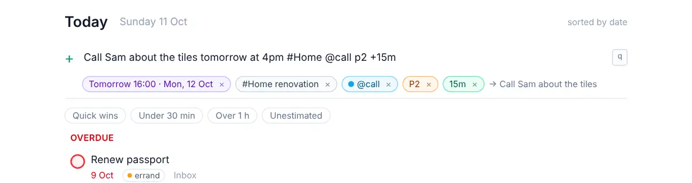

# Work from the list

<picture><source srcset="images/quick-add-dark.webp" media="(prefers-color-scheme: dark)"></picture>

Most of the day happens in a list: the Inbox, Today or a project. You can do a lot there without opening a task.

## Add a task

Press <kbd>q</kbd> anywhere in a task list, type, and press <kbd>Enter</kbd>. The box stays focused so you can add several in a row.

You can fill in details as you type:

```
Order new taps friday #Home @errand p2 +20m
```

This creates "Order new taps", due Friday, in the project Home, with the label errand, priority 2 and an estimate of 20 minutes. Chips under the box show what was understood before you press Enter. The [quick add reference](quick-add.md) has every word and symbol it knows.

New tasks without a project land in the **Inbox**. Tasks added inside a project go into that project, and tasks added in **Today** are due today.

## Complete, reopen and delete

Click the circle next to a task, or press <kbd>c</kbd>. Completed tasks move to **Completed** in the sidebar, where you can reopen them.

Deleting a task (the **Delete** button in the panel, or <kbd>Delete</kbd> in the list) moves it to the Trash, along with its subtasks. You can restore it from there. See [Trash and history](trash-and-history.md).

Completing, deleting, moving, rescheduling or parking a task shows a toast with **Undo** for a few seconds (<kbd>Ctrl</kbd>+<kbd>Z</kbd> outside a text field also undoes). Undo works offline too.

## What a row shows

With **Calm** rows (the default) a row leaves out what the view already says: no "Today" in Today (the time stays), no date under an Upcoming day, no project inside that project, no chip for the open label. Dates are grey unless overdue (red) or timed for today; only P1 and P2 colour the circle. Labels are dots with the first name and "+2"; hover or focus them to see all. Subtask progress, comments and attachments sit at the end of the row, faint until you hover it. **Detailed** rows in Settings → Appearance show every chip.

## Quick changes from the list

You don't have to open a task to change it. Select it and press:

| Key | Does |
| --- | --- |
| <kbd>1</kbd> to <kbd>4</kbd> | Set the priority |
| <kbd>c</kbd> | Complete or reopen |
| <kbd>L</kbd> | Add labels (type to search, <kbd>Enter</kbd> to add or create) |
| <kbd>e</kbd> | Set the estimate (`20`, `45m`, `1h30`) |
| <kbd>d</kbd> | Set the deadline (`fri`, `2026-11-06`) |
| <kbd>n</kbd> | Park in Someday, or bring back |
| <kbd>Shift</kbd>+<kbd>N</kbd> | Defer: type the start date |
| <kbd>Shift</kbd>+<kbd>E</kbd> | Toggle This Evening |
| <kbd>x</kbd> | Tick for a bulk action (see [Change several tasks at once](bulk-actions.md)) |
| <kbd>s</kbd> | Schedule it on the Day calendar |
| <kbd>Delete</kbd> | Move it to the Trash |

## Put things in order

In the Inbox and in projects, you decide the order. Drag a task to a new place (on a touch screen, press and hold first), or select it and press <kbd>Alt</kbd>+<kbd>↑</kbd> / <kbd>Alt</kbd>+<kbd>↓</kbd>. <kbd>Alt</kbd>+<kbd>Shift</kbd>+<kbd>↑</kbd> sends it to the top. Dropping a task on the middle of another one makes it a subtask. Projects in the sidebar can be reordered the same way.

Today, Upcoming, labels and filters sort themselves by date and priority, so dragging is switched off there.
