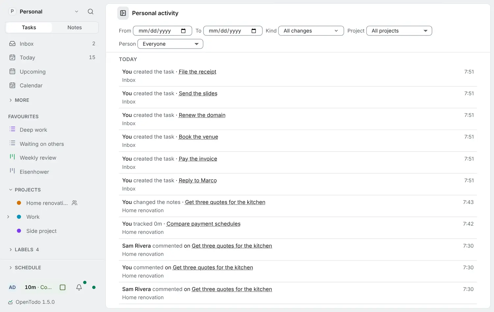

# Workspace activity

<picture><source srcset="images/workspace-activity-dark.webp" media="(prefers-color-scheme: dark)"></picture>

A workspace's **Activity** lists every change in its projects and its Inbox, by you and by everyone you share with, newest first and grouped by day. Use it for a weekly look back, or to see where the time went.

## Open it

Open the workspace menu, at the top of the sidebar, and choose **Activity**. It shows the workspace you are in. Opening it marks nothing as seen: the unread counts of [Updates](comments-and-activity.md#see-what-others-changed) stay as they were.

You see what you can read: your own projects and Inbox tasks in the workspace, and the shared projects of the workspace you are a member of. Another member's personal projects, and shared projects you are not in, never appear.

## Filter

- **From** and **To** pick a range of days, both included. Leave one empty for no bound.
- **Kind** takes several kinds at once: a change is listed when it has any of them. Choose **All changes** to clear it.
- **Project** narrows to one project or the Inbox, and **Person** to one person.

The page remembers its filters on this device for each workspace and restores them when you open it again. A chosen week stays that week. Another device keeps its own choice.

## Time tracked

Logging time on a task, or stopping its timer, shows as "tracked 42m" on the task, under the kind **Time tracked**. Editing or deleting an entry shows as "changed tracked time". A running timer appears once it stops. The note of a time entry is never shown in activity.

The same events appear on the task's **Activity** tab, in a project's activity and in Updates.

## Offline

Offline, the page lists the changes this device keeps, with the filters applied. Online, it also loads them from the server, and **Load older activity** fetches earlier ones, without listing anything twice.
