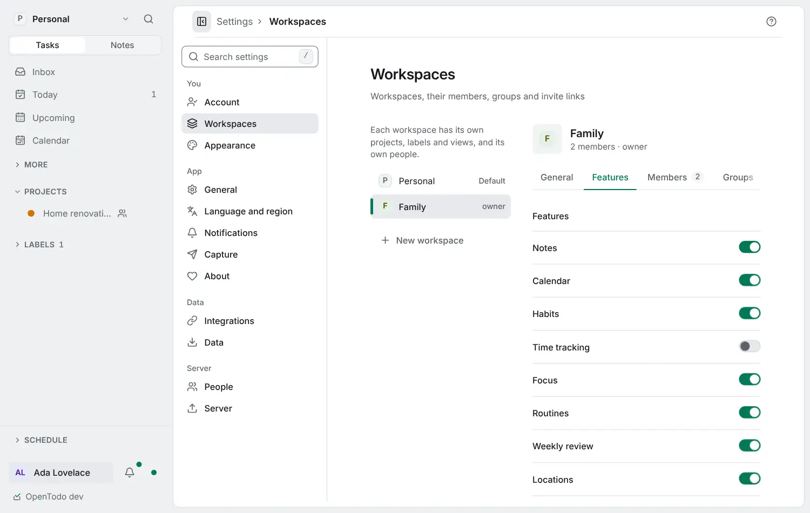

# Workspace features

<picture><source srcset="images/workspace-features-dark.webp" media="(prefers-color-scheme: dark)"></picture>

A family workspace may not need time tracking, and a team may not want habits. Each workspace, your default one too, can show only the features its people use.

## Switch a feature

Open **Settings → Workspaces**, pick the workspace and choose the **Features** tab. It has one switch per feature:

- **Notes**, with daily notes
- **Calendar**, with time blocks
- **Habits**
- **Time tracking**, with the planned and tracked totals on Today
- **Focus**
- **Routines**
- **Reviews**: the Daily check, Close the day, the weekly review, Statistics and Objectives
- **Locations**, with maps

Everything starts on. The owner and admins change the switches for everyone in the workspace, and it needs a connection to your server. Other members see the switches but cannot change them; their devices follow at the next sync.

Tasks, projects, labels, the Inbox, Today, Upcoming, search, views, sharing, comments, reminders, repeating tasks, Completed and Trash are always there.

## What off means

While that workspace is open, a feature that is off leaves the sidebar, search and the task menus, and its keys do nothing. Switch to another workspace and it is back.

Nothing is deleted. Tasks keep their locations and time entries, habits keep their days, and turning the feature on again shows everything as it was. A link to the feature's page says it is off, with **Turn on** for the owner and admins. Off never stops anything: a running timer keeps its **Stop**, and a running Focus session can be stopped from that page. The feature's Settings sections stay.

Your own switches still apply on top: with Habits on in the workspace, you see habits only if **Habits** is on in [How you work](settings-you.md#how-you-work). While a workspace has a feature off, its row there is hidden.

The [API](api.md#workspaces), the [command line](cli.md), [MCP](mcp.md), the export and [CalDAV](caldav.md) work on every feature's data whatever the switches say.
